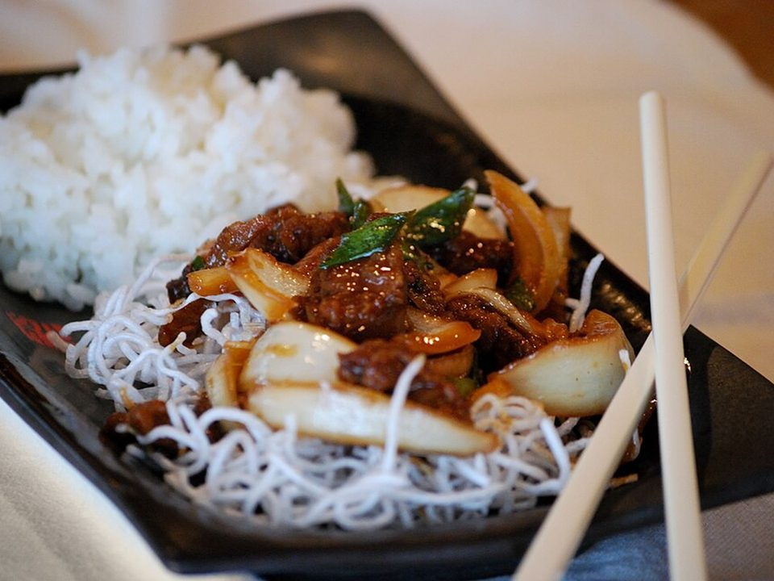

# Mongolian Beef

Photo: Craig Dugas from Bozeman, Montana, USA · CC BY-SA 2.0 · [source](https://commons.wikimedia.org/wiki/File:Mongolian_Beef_with_rice_and_noodles.jpg)

**Dinner** · Chinese & Cantonese · 25 min · serves 4 · skill 1/3

> Thin, lightly crisped flank steak tossed with scallions in a sticky brown-sugar, ginger and garlic soy glaze.

| Per serving | kcal | Protein | Carbs | Fat | Fiber | Sodium | Cost |
| --- | --- | --- | --- | --- | --- | --- | --- |
| | 690 | 43 g | 74 g | 24 g | 3 g | 1020 mg | $4.05 |

Contains: beef, gluten

## Ingredients

- 1½ lb flank steak, sliced thin across the grain
- ⅓ cup soy sauce
- ¼ cup brown sugar or honey
- 5 garlic cloves, minced
- 1-inch ginger, grated
- 1 bunch green onions, in 2-inch pieces
- 1½ cups rice
- ½ lb broccoli (optional side)

From the pantry: ⅓ cup cornstarch, 3 tbsp oil, red pepper flakes

## Steps

1. Start the rice. Toss the beef with the cornstarch until every slice is lightly coated.
2. Sear the beef in 2 tbsp oil over high heat in two batches, 1 to 2 minutes per side, until browned and crisp at the edges. Move to a plate.
3. Lower the heat. Add the remaining oil, garlic, ginger and pepper flakes for 30 seconds.
4. Add the soy, sugar and ⅓ cup water and simmer until syrupy, 2 minutes.
5. Return the beef with the green onions and toss for 1 minute. Serve over rice with broccoli.

**Tip:** Slice against the grain. Look for the lines running through the meat and cut across them, not along.

## Storing

Fridge 4 days · freezer up to 2 months. Reheat in a skillet with a splash of water, 3 minutes.

## Other ways to make it

- Chicken
- Shrimp
- Pork
- Tofu
