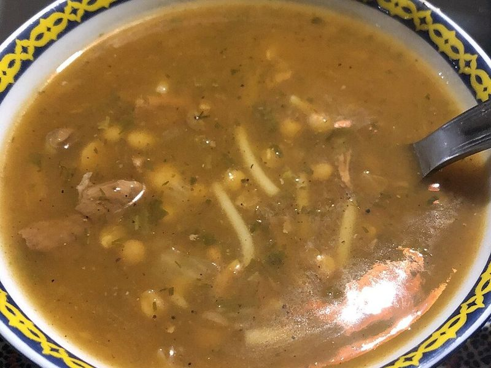

# Harira (Moroccan Tomato, Lentil & Chickpea Soup)

Photo: إيان · CC BY-SA 4.0 · [source](https://commons.wikimedia.org/wiki/File:%D8%AD%D8%B1%D9%8A%D8%B1%D8%A9.jpg)

**Lunch** · Moroccan · 60 min · serves 6 · skill 1/3

> Morocco's Ramadan soup: lentils, chickpeas and broken noodles in a tomato broth scented with ginger, turmeric and cinnamon, with fistfuls of herbs and a squeeze of lemon.

| Per serving | kcal | Protein | Carbs | Fat | Fiber | Sodium | Cost |
| --- | --- | --- | --- | --- | --- | --- | --- |
| | 475 | 21 g | 79 g | 10 g | 13 g | 890 mg | $1.24 |

Contains: gluten

## Ingredients

- 1 can (15.5 oz) chickpeas, rinsed
- 1 cup brown or green lentils, rinsed
- 1 can (28 oz) crushed tomatoes
- 1 onion, chopped
- 2 celery stalks, chopped
- 2 carrots, chopped
- 4 garlic cloves, minced
- 1 tbsp grated ginger
- ½ bunch cilantro, chopped
- ½ bunch parsley, chopped
- 2 oz thin spaghetti, broken into short bits
- 2 lemons, in wedges
- 1 baguette, for serving

From the pantry: 3 tbsp olive oil, 2 tbsp flour, 2 tsp turmeric, 1 tsp ground cinnamon, 1 tsp ground cumin, 1 tsp black pepper, 2 vegetable bouillon cubes, salt

## Steps

1. Heat the oil in a large pot over medium. Cook the onion, celery and carrots with a pinch of salt until soft, 7 minutes. Stir in the garlic, ginger, turmeric, cinnamon, cumin and pepper for 1 minute.
2. Add half the herbs, the tomatoes, lentils, bouillon and 8 cups water. Bring to a boil, then simmer partly covered until the lentils are tender, 25 to 30 minutes.
3. Add the chickpeas and broken pasta and simmer until the pasta is soft, 8 to 10 minutes.
4. Whisk the flour with ½ cup water and stir it in slowly. Simmer 3 to 4 minutes, stirring, until the soup turns silky. Season with salt.
5. Stir in the remaining herbs and serve with lemon wedges and bread.

**Tip:** The flour-and-water slurry (tadouira) is what gives harira its velvety body, so don't skip it. Many families add small cubes of beef or chicken with the lentils; a pinch of saffron is a nice touch.

Adapted from [The International Kitchen](https://www.theinternationalkitchen.com/recipes/moroccan-harira-chickpea-and-lentil-soup/).

## Storing

Fridge 5 days · freezer up to 3 months. The soup thickens overnight; add water. Reheat on the stove over medium until simmering, 5 minutes.

