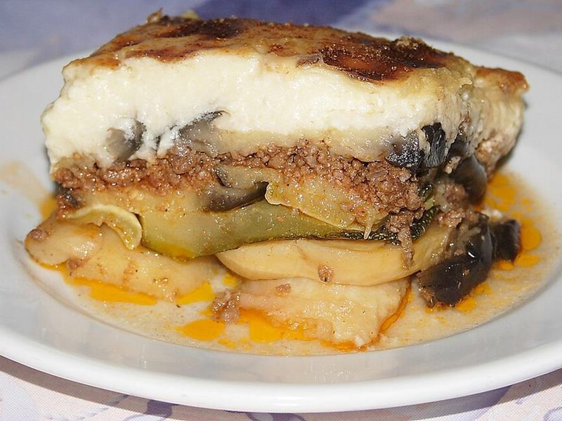

# Greek Moussaka with Cinnamon Meat Sauce & Béchamel

Photo: Robert Kindermann aka RobertK · CC BY-SA 2.5 · [source](https://commons.wikimedia.org/wiki/File:MussakasMeMelitsanesKePatates01.JPG)

**Dinner** · Greek · 120 min · serves 6 · skill 3/3

> Silky roasted eggplant layered with a cinnamon-warmed tomato meat sauce under a thick, golden béchamel crown. A weekend project that feeds a crowd and tastes even better the next day.

| Per serving | kcal | Protein | Carbs | Fat | Fiber | Sodium | Cost |
| --- | --- | --- | --- | --- | --- | --- | --- |
| | 720 | 34 g | 42 g | 48 g | 9 g | 680 mg | $2.52 |

Contains: gluten, dairy, egg, beef

## Ingredients

- 2 large eggplants (about 2½ lb), in ½-inch rounds
- 1 lb russet potatoes, peeled and thinly sliced
- 1½ lb ground beef or ground turkey
- 1 onion, finely diced
- 3 garlic cloves, minced
- 1 (14 oz) can crushed tomatoes (half a 28 oz can)
- 3 cups milk
- 4 tbsp butter
- 2 eggs
- ⅔ cup grated Parmesan, divided

From the pantry: 5 tbsp olive oil, ¼ cup flour, 2 tbsp tomato paste, 1 tsp cinnamon, 1 tsp dried oregano, ¼ tsp nutmeg, 2 tsp salt, ½ tsp black pepper

## Steps

1. Heat the oven to 425°F. Brush the eggplant and potato slices with 4 tbsp of the oil, season with salt, and roast on two sheet pans until soft and golden, 20 to 25 minutes. Lower the oven to 375°F.
2. Meanwhile brown the beef in the remaining oil over medium-high, breaking it up, 6 to 8 minutes. Add the onion and garlic and cook 4 minutes, then stir in the tomato paste, crushed tomatoes, cinnamon, oregano, 1 tsp salt and the pepper. Simmer until thick, 15 minutes.
3. For the béchamel, melt the butter over medium, whisk in the flour and cook 1 minute. Slowly whisk in the milk and simmer, whisking, until it coats a spoon, 5 to 6 minutes. Off the heat, whisk in the nutmeg, half the Parmesan, then the eggs.
4. In a 9x13 dish, layer the potatoes, half the eggplant, all the meat sauce, then the rest of the eggplant. Pour over the béchamel and sprinkle with the remaining Parmesan.
5. Bake until the top is deep golden and bubbling at the edges, 40 to 45 minutes. Let it rest at least 20 minutes before cutting so the layers hold.

**Tip:** Roasting the eggplant instead of frying it keeps the dish from going greasy and saves a lot of standing at the stove.

## Storing

Fridge 4 days · freezer up to 3 months. Reheat squares covered at 350°F for 20 to 25 minutes, or microwave a portion 2 to 3 minutes.

## Other ways to make it

- Ground turkey
- Ground pork
- Italian sausage
- Lentils (veg)
