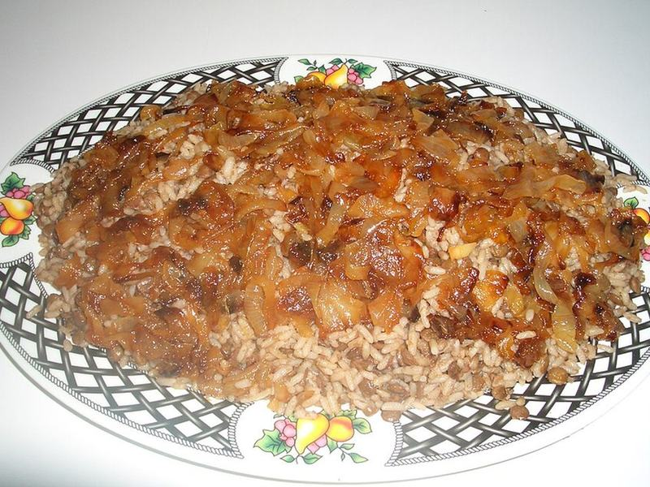

# Mujadara (Lentils & Rice with Crispy Onions)

Photo: Bazel · CC BY-SA 3.0 · [source](https://commons.wikimedia.org/wiki/File:Mujaddara.jpg)

**Dinner** · Middle Eastern · 50 min · serves 5 · skill 1/3

> The Levant's beloved comfort food: cumin-scented lentils and rice under a heap of sweet, crispy fried onions, with yogurt and a chopped salad.

| Per serving | kcal | Protein | Carbs | Fat | Fiber | Sodium | Cost |
| --- | --- | --- | --- | --- | --- | --- | --- |
| | 540 | 22 g | 81 g | 16 g | 12 g | 270 mg | $1.30 |

Contains: dairy

## Ingredients

- 1 cup brown lentils
- 1 cup basmati rice
- 4 onions, thinly sliced
- 1 cup Greek yogurt
- 1 cucumber
- 2 tomatoes
- parsley
- 1 lemon

From the pantry: ½ cup olive oil, 2 tsp cumin, 1 tsp allspice, salt

## Steps

1. Simmer the lentils in salted water for 15 minutes, until just tender. Drain.
2. Fry the onions in the oil over medium-high, stirring often, until deep brown and crisp, 20 to 25 minutes. Drain on paper towels, keeping the oil.
3. In the same pot, toast the rice and spices in 2 tbsp onion oil for 1 minute. Add the lentils, 2 cups water and 1 tsp salt. Cover and simmer 15 minutes, then rest 10.
4. Chop the cucumber, tomatoes and parsley with lemon and olive oil.
5. Fluff the mujadara and pile the crispy onions on top. Serve with yogurt and salad.

**Tip:** Toss the onions with a tablespoon of cornstarch before frying for extra-crunchy results.

## Storing

Fridge 5 days · freezer up to 3 months. Microwave with a splash of water. Store crispy onions separately so they stay crunchy.

