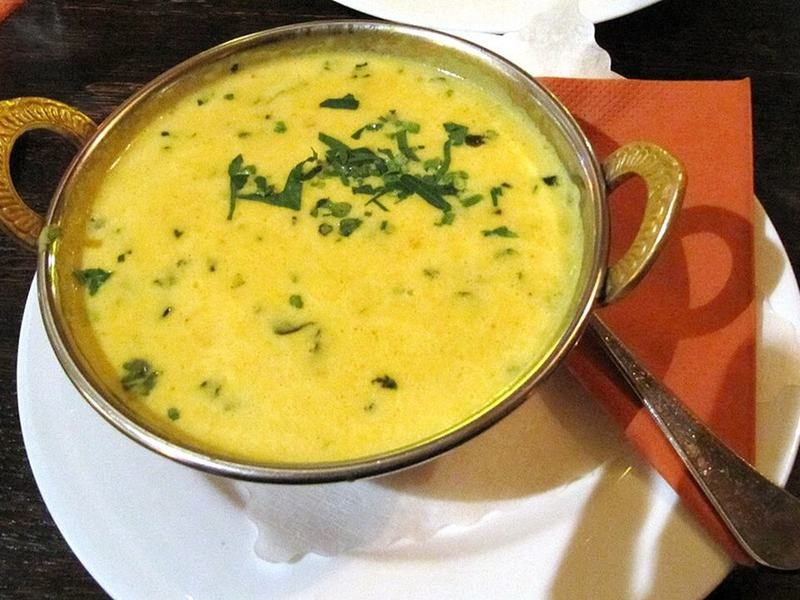

# Mulligatawny (Curried Chicken & Lentil Soup)

Photo: GeoTrinity · CC BY-SA 3.0 · [source](https://commons.wikimedia.org/wiki/File:Mulligatawny-Soup_Mumbai.jpg)

**Lunch** · North Indian · 50 min · serves 6 · skill 1/3

> An Anglo-Indian classic: a gently spiced curry soup of chicken, red lentils, apple and coconut milk, served over a spoonful of basmati. It's warming, a little sweet and very satisfying.

| Per serving | kcal | Protein | Carbs | Fat | Fiber | Sodium | Cost |
| --- | --- | --- | --- | --- | --- | --- | --- |
| | 605 | 37 g | 60 g | 25 g | 8 g | 1350 mg | $2.43 |

Contains: none of the tracked allergens

## Ingredients

- 1½ lb boneless chicken thighs
- 1 cup red lentils, rinsed
- 8 cups chicken broth
- 1 can coconut milk
- 1 tart apple, peeled and diced
- 1 large onion, chopped
- 2 carrots, diced
- 2 celery stalks, diced
- 4 garlic cloves, minced
- 1 tbsp grated ginger
- 2 tbsp curry powder
- 1 cup basmati rice, for serving
- 1 lemon, juiced
- cilantro, for serving

From the pantry: 2 tbsp oil, ½ tsp ground cumin, 2 tsp salt, ½ tsp pepper

## Steps

1. Heat the oil in a large pot over medium heat. Cook the onion, carrots and celery until soft, 8 minutes. Stir in the garlic, ginger, curry powder and cumin and cook until fragrant, 1 minute.
2. Add the broth, lentils, apple, whole chicken thighs, salt and pepper. Bring to a boil, then simmer partly covered until the lentils break down and the chicken is tender, 25 minutes. Start the rice meanwhile.
3. Lift out the chicken and shred it with two forks. Blend about half the soup with an immersion blender to thicken it, leaving some texture.
4. Stir in the coconut milk and shredded chicken and simmer 5 minutes. Add lemon juice and taste for salt.
5. Spoon rice into bowls, ladle the soup over, and top with cilantro.

**Tip:** Toast the curry powder in the oil for a full minute before adding liquid. It takes the raw, dusty edge off the spices.

## Storing

Fridge 5 days · freezer up to 3 months. Store the rice separately. Reheat the soup over medium with a splash of broth, since it thickens as it sits.

## Other ways to make it

- Steak
- Shrimp
- Pork
- Tofu
