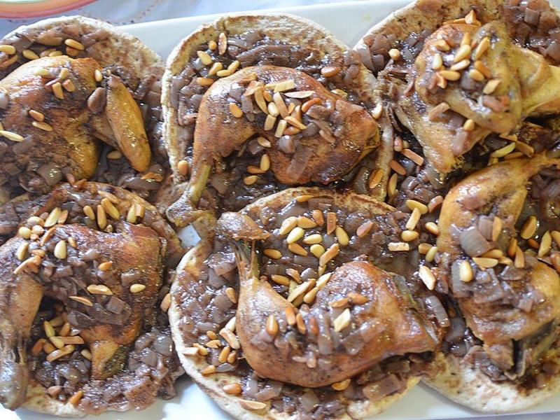

# Musakhan (Sumac-Onion Roast Chicken on Flatbread)

Photo: Kokaly · CC BY-SA 3.0 · [source](https://commons.wikimedia.org/wiki/File:Mushakhan_Dish.jpg)

**Dinner** · Lebanese & Levantine · 75 min · serves 4 · skill 2/3

> Palestine's beloved Sunday dish: chicken roasted under a heap of olive-oil-soaked, sumac-stained onions, piled onto flatbread that drinks up every drop.

| Per serving | kcal | Protein | Carbs | Fat | Fiber | Sodium | Cost |
| --- | --- | --- | --- | --- | --- | --- | --- |
| | 750 | 59 g | 64 g | 30 g | 8 g | 880 mg | $3.78 |

Contains: gluten, dairy

## Ingredients

- 2 lb boneless chicken thighs
- 4 large yellow onions (about 2 lb), thinly sliced
- ¼ cup ground sumac, plus more to finish
- 3 garlic cloves, minced
- 1 lemon
- 4 large pita or taboon-style flatbreads
- ½ bunch parsley, chopped
- 1 cup plain Greek yogurt, to serve

From the pantry: ½ cup olive oil, 1 tsp allspice, 1 tsp cumin, ½ tsp cinnamon, 1½ tsp salt, ½ tsp black pepper

## Steps

1. Heat the oven to 425°F. Toss the chicken with 2 tbsp of the oil, half the sumac, the allspice, cumin, cinnamon, garlic, the juice of half the lemon, 1 tsp salt and the pepper.
2. Warm the rest of the oil in a large skillet over medium-low and add the onions with ½ tsp salt. Cook, stirring now and then, until very soft and golden but not browned, 20 to 25 minutes. Stir in the rest of the sumac.
3. Spread half the onions in a baking dish, lay the chicken on top and cover with the remaining onions. Roast until the chicken reaches 175°F inside and the onion edges are caramelized, 25 to 30 minutes.
4. Brush the flatbreads with the oily pan juices and warm them on the oven rack until crisp at the edges, 3 to 4 minutes.
5. Pile the onions and chicken onto the flatbreads, spoon over more juices, and finish with parsley, a squeeze of lemon and a dusting of sumac. Serve with yogurt.

**Tip:** Don't skimp on the oil or rush the onions: slow, soft, oily onions are the whole point, and the bread is meant to soak them up.

## Storing

Fridge 3 days · freezer up to 2 months. Store chicken and onions apart from the bread. Reheat covered at 350°F for 15 minutes, then crisp fresh flatbread on the rack.

## Other ways to make it

- Steak
- Shrimp
- Pork
- Tofu
