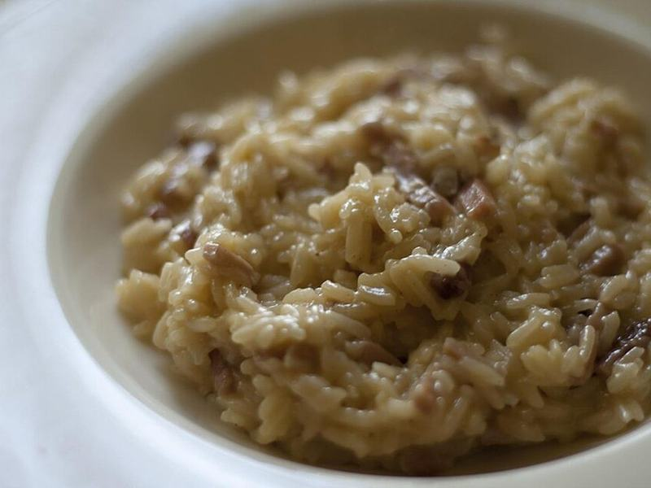

# Mushroom & Parmesan Risotto

Photo: Luca Nebuloni from Milan, Italy · CC BY 2.0 · [source](https://commons.wikimedia.org/wiki/File:Risotto_with_speck_and_goat_cheese_(6101067436).jpg)

**Dinner** · Italian · 45 min · serves 4 · skill 2/3

> Creamy, slow-stirred arborio rice with deeply browned mushrooms, garlic and a generous fistful of Parmesan. Comfort food that's worth every minute at the stove.

| Per serving | kcal | Protein | Carbs | Fat | Fiber | Sodium | Cost |
| --- | --- | --- | --- | --- | --- | --- | --- |
| | 630 | 17 g | 77 g | 29 g | 3 g | 1990 mg | $2.99 |

Contains: dairy

## Ingredients

- 1½ cups arborio rice
- 1 lb sliced baby bella mushrooms
- 6 cups vegetable broth, kept warm
- 1 onion, finely diced
- 3 garlic cloves, minced
- 4 tbsp butter, divided
- 1 cup grated Parmesan
- ½ bunch parsley, chopped
- a squeeze of lemon

From the pantry: 3 tbsp olive oil, ½ cup dry white wine (or extra broth), 1 tsp dried thyme, 1 tsp salt, ½ tsp black pepper

## Steps

1. Heat 2 tbsp oil and 1 tbsp butter in a wide pot over medium-high. Add the mushrooms in an even layer and leave them until well browned, 6 to 8 minutes, then stir, season with salt and thyme, and move half to a bowl.
2. Lower the heat to medium, add the remaining oil, the onion and garlic, and cook until soft, 4 minutes. Add the rice and stir until the edges turn translucent, 2 minutes.
3. Pour in the wine and stir until absorbed. Add the warm broth a ladle at a time, stirring often and waiting until each addition is almost absorbed before adding the next, until the rice is creamy and just tender, 20 to 25 minutes.
4. Off the heat, stir in the remaining butter, the Parmesan, pepper and a squeeze of lemon. It should flow slowly like lava; loosen with a splash of broth if needed.
5. Spoon into warm bowls and top with the reserved mushrooms and parsley.

**Tip:** Don't crowd or stir the mushrooms early. Letting them sit in a hot pan gives the browned, meaty flavor the whole dish depends on.

## Storing

Fridge 3 days · freezer not recommended. Risotto thickens in the fridge. Reheat in a skillet with a few splashes of broth, stirring, 4 to 5 minutes, or press it into patties and pan-fry.

