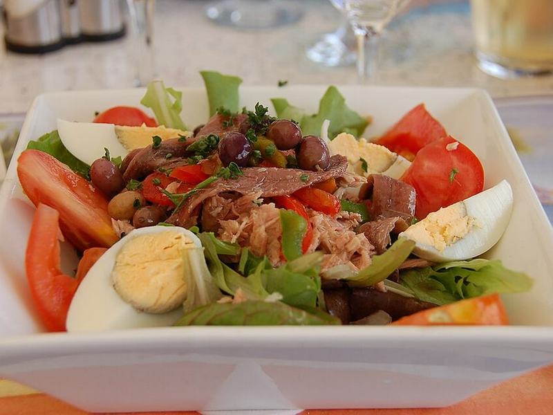

# Tuna Niçoise Salad with Dijon Vinaigrette

Photo: Wusel007 · CC BY-SA 3.0 · [source](https://commons.wikimedia.org/wiki/File:Nizza-Salat_an_der_F_Mittelmeerk%C3%BCste.JPG)

**Lunch** · French & Spanish · 35 min · serves 4 · skill 2/3

> A composed French platter of good tuna, jammy eggs, tender potatoes, crisp green beans, tomatoes and olives over greens, dressed in a sharp mustardy vinaigrette.

| Per serving | kcal | Protein | Carbs | Fat | Fiber | Sodium | Cost |
| --- | --- | --- | --- | --- | --- | --- | --- |
| | 525 | 34 g | 46 g | 25 g | 10 g | 880 mg | $3.93 |

Contains: fish, egg

## Ingredients

- 3 cans albacore tuna, drained
- 1½ lb baby potatoes
- 12 oz green beans, trimmed
- 4 eggs
- 1 pint grape tomatoes, halved
- ½ cup Kalamata or Niçoise olives
- 2 romaine hearts, torn
- 1 lemon
- 1 small shallot or ¼ red onion, minced

From the pantry: ⅓ cup olive oil, 2 tbsp red wine vinegar, 1 tbsp Dijon mustard, 1 tsp dried thyme, salt, pepper

## Steps

1. Put the potatoes in a pot of cold salted water, bring to a boil and cook until a knife slides in easily, 12 to 15 minutes. Lift them out with a slotted spoon and halve them.
2. In the same boiling water, cook the green beans until bright and crisp-tender, 3 minutes; scoop into ice water. Then lower in the eggs and boil 7 minutes for jammy yolks, and chill them in the ice water.
3. Whisk the olive oil, vinegar, Dijon, shallot, thyme, a squeeze of lemon, salt and pepper. Toss the warm potatoes with 2 tbsp of it so they soak it up.
4. Peel and halve the eggs. Arrange the lettuce on a platter or in containers and group the potatoes, beans, tomatoes, olives, eggs and chunks of tuna on top.
5. Drizzle with the remaining vinaigrette, season with pepper and serve.

**Tip:** Dressing the potatoes while they're still warm is what makes them taste seasoned all the way through.

## Storing

Fridge 3 days · freezer not recommended. Pack the components and dressing separately and assemble at lunchtime. Eat cold.

