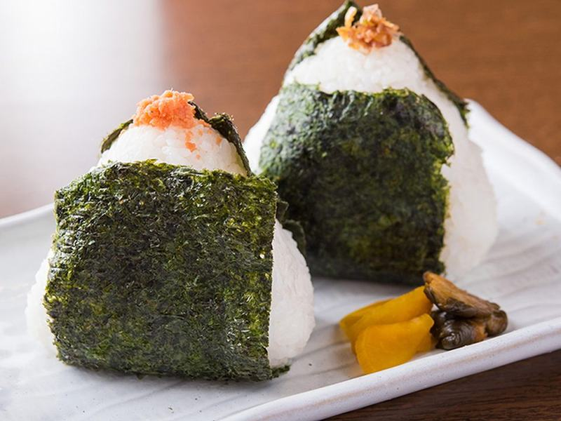

# Salmon Onigiri with Smashed Cucumber Salad

Photo: 脇山航 · CC BY-SA 4.0 · [source](https://commons.wikimedia.org/wiki/File:%E5%B0%8F%E6%96%99%E7%90%86%E3%83%90%E3%83%AB%E3%81%95%E3%81%8F%E3%82%89_%E7%89%B9%E8%A3%BD%E3%81%8A%E3%81%AB%E3%81%8E%E3%82%8A.jpg)

**Lunch** · Japanese · 40 min · serves 4 · skill 2/3

> Warm rice triangles stuffed with flaky soy-glazed salmon and wrapped in crisp nori, served with a punchy sesame-vinegar cucumber salad. A Japanese convenience-store classic, only better.

| Per serving | kcal | Protein | Carbs | Fat | Fiber | Sodium | Cost |
| --- | --- | --- | --- | --- | --- | --- | --- |
| | 595 | 27 g | 84 g | 16 g | 3 g | 680 mg | $3.02 |

Contains: fish, sesame, gluten

## Ingredients

- 12 oz salmon fillet
- 2 cups short-grain rice
- 4 nori sheets, cut in half
- 2 English cucumbers
- 2 tbsp toasted sesame seeds
- 2 tbsp soy sauce
- 2 green onions, sliced

From the pantry: 3 tbsp rice vinegar, 2 tsp sugar, 2 tsp sesame oil, 1½ tsp salt, ½ tsp chili flakes

## Steps

1. Rinse the rice until the water runs nearly clear, then cook it with 2¼ cups water. Let it rest, covered, 10 minutes.
2. Meanwhile, season the salmon with a pinch of salt and roast at 425°F until it flakes easily, 10 to 12 minutes. Flake it, discarding the skin, and toss with 1 tbsp soy sauce, the green onions and 1 tbsp sesame seeds.
3. For the salad, smash the cucumbers lightly with the flat of a knife, break them into bite-size pieces and toss with 1 tsp salt. After 10 minutes drain them, then toss with the vinegar, sugar, sesame oil, the rest of the soy, the chili flakes and the remaining sesame seeds.
4. Wet your hands and rub them with a little salt. Take about ⅔ cup warm rice, press a dent in the middle, add a spoonful of salmon and close the rice over it.
5. Cup your hands and press the rice firmly into a triangle, turning it 3 or 4 times. Wrap a half sheet of nori around the base, and serve with the cucumber salad.

**Tip:** Shape the rice while it's still warm, and keep your hands wet and salted. Cold rice won't stick together, and the salt on your hands seasons the outside.

## Storing

Fridge 1 days · freezer not recommended. Wrap each onigiri tightly in plastic and keep the nori separate so it stays crisp. Eat at room temperature, or microwave 20 seconds if the rice has firmed up.

## Other ways to make it

- Cod
- Shrimp
- Chicken
