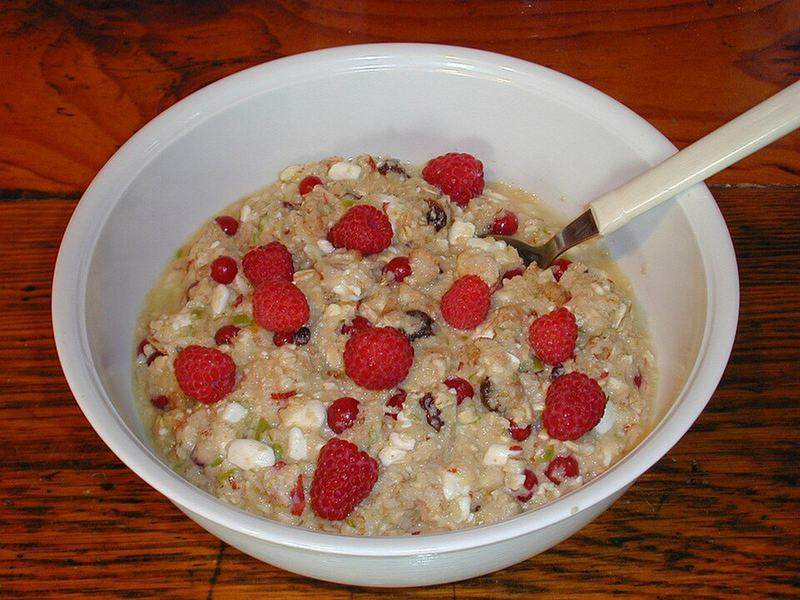

# Berry Vanilla Overnight Oats

Photo: Markus Kuhn at en.wikipedia · Public domain · [source](https://commons.wikimedia.org/wiki/File:Fresh-muesli.jpg)

**Breakfast** · American comfort · 5 min · serves 4 · skill 1/3

> Four grab-and-go jars of creamy, protein-packed oats with chia and jammy berries. Make them Sunday night for the week.

| Per serving | kcal | Protein | Carbs | Fat | Fiber | Sodium | Cost |
| --- | --- | --- | --- | --- | --- | --- | --- |
| | 380 | 18 g | 58 g | 10 g | 11 g | 380 mg | $1.28 |

Contains: dairy, gluten

## Ingredients

- 2 cups rolled oats
- 1 cup plain Greek yogurt
- 2 cups milk
- 3 tbsp chia seeds
- 3 tbsp honey
- 2 cups frozen mixed berries

From the pantry: 1 tsp vanilla extract, pinch of salt

## Steps

1. Whisk the milk, yogurt, honey, vanilla and salt in a large bowl.
2. Stir in the oats and chia seeds.
3. Divide among 4 jars, top each with ½ cup frozen berries and seal.
4. Refrigerate overnight or up to 4 days. The berries thaw into a quick jam.
5. Stir before eating and add a drizzle of honey if you like.

**Tip:** Costco's 4-lb berry bag covers a month of jars. Leave it in the freezer.

## Storing

Fridge 4 days · freezer not recommended. Keep jars sealed in the fridge. Eat cold, or microwave 1 minute.

