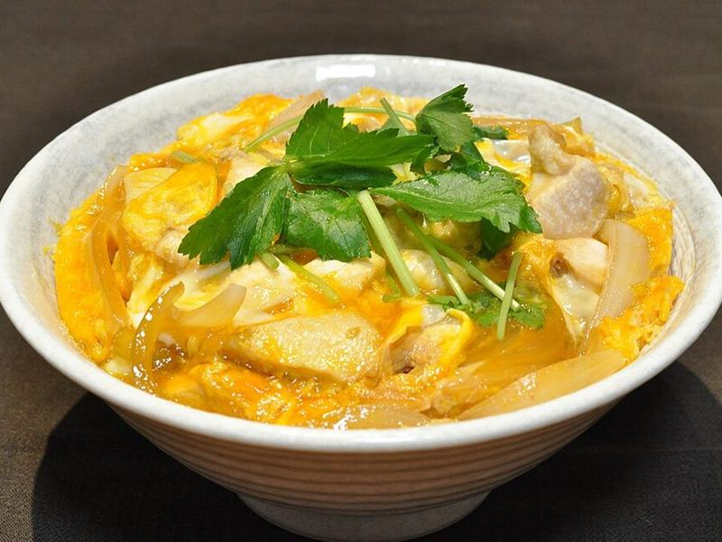

# Oyakodon (Chicken & Egg Rice Bowls)

Photo: Ocdp · CC0 · [source](https://commons.wikimedia.org/wiki/File:Oyakodon_003.jpg)

**Dinner** · Japanese · 30 min · serves 4 · skill 1/3

> Chicken and sweet onions simmered in a soy-mirin broth, then set with softly scrambled egg and slid over hot rice. It's Japan's homey one-pan comfort bowl.

| Per serving | kcal | Protein | Carbs | Fat | Fiber | Sodium | Cost |
| --- | --- | --- | --- | --- | --- | --- | --- |
| | 700 | 51 g | 85 g | 15 g | 3 g | 1050 mg | $2.50 |

Contains: gluten, egg

## Ingredients

- 1½ lb boneless thighs, in bite-size pieces
- 6 eggs
- 1 large onion, thinly sliced
- 1 cup chicken broth (or dashi)
- ¼ cup soy sauce
- 4 green onions, thinly sliced
- 2 cups short-grain or jasmine rice

From the pantry: 3 tbsp mirin, 1 tbsp sugar, shichimi togarashi to serve (optional)

## Steps

1. Start the rice. In a large skillet, stir the broth, soy sauce, mirin and sugar and bring to a simmer over medium heat.
2. Add the onion and simmer until it softens and turns translucent, 4 to 5 minutes.
3. Add the chicken in an even layer, cover and simmer, turning once, until cooked through and 165°F inside, 6 to 8 minutes.
4. Lightly beat the eggs so the whites and yolks are only loosely mixed. Pour two-thirds over the chicken, cover and cook 1 minute. Pour in the rest, sprinkle with green onions, cover and turn off the heat. Let it sit 1 minute, until the egg is just set but still soft.
5. Spoon rice into bowls and slide the chicken, egg and some of the broth over the top. Sprinkle with togarashi if you like.

**Tip:** Don't over-beat the eggs. Streaks of white and yolk give the classic silky, marbled texture.

## Storing

Fridge 2 days · freezer not recommended. Store the topping apart from the rice. Reheat gently, covered, in the microwave at 50% power so the egg doesn't turn rubbery.

## Other ways to make it

- Steak
- Shrimp
- Pork
- Tofu
