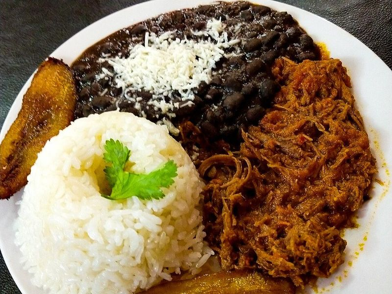

# Pabellón Criollo (Venezuelan Shredded Beef, Black Beans, Rice & Plantains)

Photo: Byfreddygutierrez · CC BY-SA 4.0 · [source](https://commons.wikimedia.org/wiki/File:Pabell%C3%B3n_Criollo_Venezolano_1.jpg)

**Dinner** · Venezuelan · 150 min · serves 6 · skill 2/3

> Venezuela's national dish: tender flank steak shredded and simmered in a peppery tomato sofrito, served with sweet black beans, white rice, fried ripe plantains and crumbled white cheese.

| Per serving | kcal | Protein | Carbs | Fat | Fiber | Sodium | Cost |
| --- | --- | --- | --- | --- | --- | --- | --- |
| | 890 | 53 g | 100 g | 32 g | 15 g | 1050 mg | $4.20 |

Contains: dairy

## Ingredients

- 2 lb flank steak, in 3 pieces
- 2 onions (1 quartered, 1 finely chopped)
- 1 red bell pepper, finely chopped
- 4 garlic cloves, minced
- 1 (8 oz) can tomato sauce
- 3 (15 oz) cans black beans, undrained
- 1⅔ cups long-grain white rice
- 2 very ripe plantains
- 5 oz queso fresco, crumbled

From the pantry: 3 tbsp oil, 3 tbsp oil for frying, 1 tsp ground cumin, 1 tsp dried oregano, 1 tsp paprika, 2 tsp sugar, salt, pepper

## Steps

1. Simmer the beef with the quartered onion, 1 tsp salt and water to cover until fork-tender, about 1½ hours. Cool slightly, shred into threads and save 2 cups of the broth.
2. Heat 2 tbsp oil in a large skillet over medium heat and cook the chopped onion until soft, 5 minutes. Add the garlic, bell pepper, cumin, oregano and paprika for 3 minutes, then stir in the tomato sauce, the beef and 1½ cups broth. Cover and simmer on low 15 to 20 minutes until the sauce clings.
3. Meanwhile simmer the black beans in a pot with the last tbsp oil, the sugar and a pinch of cumin until thick and creamy, 15 minutes. Cook the rice.
4. Slice the plantains on a long diagonal and fry in the frying oil over medium heat until caramelized, 2 to 3 minutes per side.
5. Serve the beef, beans, rice and plantains side by side on each plate with crumbled cheese over the beans.

**Tip:** Venezuelans like their caraotas a little sweet; taste the beans and add more sugar if you like. A pressure cooker gets the beef tender in 35 minutes.

Adapted from [Spice Breeze](https://spicebreeze.com/blog/venezuelan-pabellon-criollo-recipe/).

## Storing

Fridge 4 days · freezer up to 3 months. Store each component separately. The beef and beans freeze well; reheat on the stove with a splash of broth or water.

