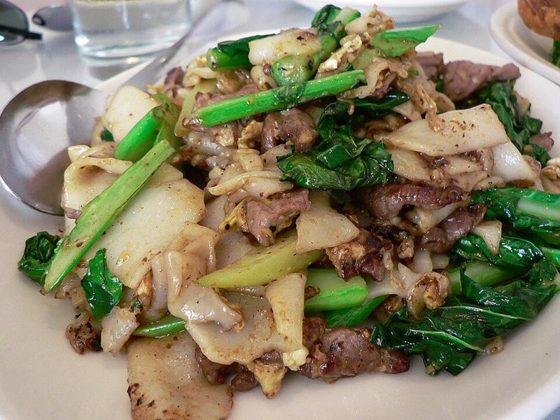

# Pad See Ew with Chicken & Chinese Broccoli

Photo: stu_spivack · CC BY-SA 2.0 · [source](https://commons.wikimedia.org/wiki/File:Pad_see_ew.jpg)

**Dinner** · Thai · 35 min · serves 4 · skill 2/3

> Wide, chewy rice noodles seared in a screaming-hot pan until smoky and caramelized, with chicken, egg and crunchy Chinese broccoli in a sweet-salty soy glaze.

| Per serving | kcal | Protein | Carbs | Fat | Fiber | Sodium | Cost |
| --- | --- | --- | --- | --- | --- | --- | --- |
| | 695 | 38 g | 84 g | 22 g | 4 g | 1160 mg | $2.47 |

Contains: gluten, egg, shellfish

## Ingredients

- 12 oz wide rice noodles
- 1 lb chicken breast or thighs, thinly sliced
- 1 lb Chinese broccoli (gai lan) or broccolini, stems sliced on an angle, leaves in 2-inch pieces
- 3 eggs
- 4 garlic cloves, minced
- ¼ cup soy sauce, divided
- 2 tbsp oyster sauce
- 1 lime, in wedges (optional)

From the pantry: 1 tbsp dark soy sauce or 1 tsp molasses, 2 tbsp sugar, 1 tsp cornstarch, 4 tbsp oil, 1 tbsp rice vinegar, red pepper flakes

## Steps

1. Soak the noodles in hot tap water until pliable but still firm, 20 to 30 minutes, or as the package says. Drain. Toss the chicken with 1 tbsp soy sauce and the cornstarch. Whisk the remaining soy sauce, dark soy, oyster sauce and sugar for the sauce.
2. Heat 1 tbsp oil in a wok or large skillet over high heat. Stir-fry the chicken until cooked through, 3 to 4 minutes. Add the garlic and Chinese broccoli stems and cook 1 minute, then the leaves and 2 tbsp water and cook until wilted, 1 minute. Move everything to a plate.
3. Add 1 tbsp oil, crack in the eggs and scramble until just set, about 30 seconds. Add to the plate.
4. Add the last 2 tbsp oil and the noodles. Pour in the sauce and toss, then let the noodles sit untouched for 30 to 45 seconds so they char in spots. Toss and repeat two or three times. Cook in two batches if your pan is small.
5. Return the chicken, eggs and greens and toss everything together. Serve with lime wedges, pepper flakes and rice vinegar for sprinkling at the table.

**Tip:** Don't stir constantly. The smoky, browned spots on the noodles are the point, and you only get them by leaving the pan alone.

## Storing

Fridge 3 days · freezer not recommended. Reheat in a hot skillet with a splash of water until the noodles soften again, 3 minutes.

## Other ways to make it

- Steak
- Shrimp
- Pork
- Tofu
