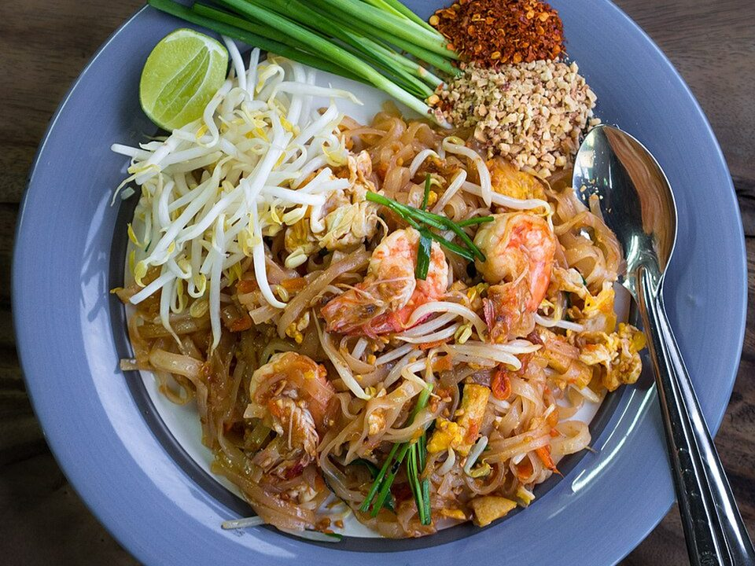

# Chicken Pad Thai

Photo: Takeaway · CC BY-SA 3.0 · [source](https://commons.wikimedia.org/wiki/File:Phat_Thai_kung_Chang_Khien_street_stall.jpg)

**Dinner** · Thai · 30 min · serves 4 · skill 2/3

> Chewy rice noodles stir-fried with chicken, egg and green onion in a sweet-sour-salty sauce, topped with crushed peanuts, lime and crunchy slaw.

| Per serving | kcal | Protein | Carbs | Fat | Fiber | Sodium | Cost |
| --- | --- | --- | --- | --- | --- | --- | --- |
| | 655 | 34 g | 74 g | 27 g | 6 g | 1100 mg | $1.98 |

Contains: gluten, egg, nuts

## Ingredients

- 8 oz flat rice noodles
- 12 oz chicken breast, thinly sliced
- 2 eggs
- 3 tbsp soy sauce (or fish sauce)
- 3 tbsp brown sugar or honey
- 3 limes
- 3 garlic cloves
- 6 green onions, in 2-inch pieces
- 2 cups coleslaw mix or bean sprouts
- ½ cup roasted peanuts, crushed
- cilantro

From the pantry: 3 tbsp oil, 2 tbsp ketchup or tamarind paste, 1 tbsp rice vinegar, chili flakes

## Steps

1. Soak the noodles in hot tap water for 25 minutes until pliable but still firm. Drain.
2. Whisk the soy, sugar, juice of 2 limes, ketchup or tamarind, vinegar and chili flakes.
3. Stir-fry the chicken in 1 tbsp oil over high heat until cooked. Push aside, scramble the eggs, then add the garlic.
4. Add the remaining oil, noodles and sauce and toss with tongs until the noodles soak up the sauce and turn tender, 3 minutes. Add a splash of water if they stick.
5. Toss in the green onions and half the slaw. Serve with peanuts, the rest of the slaw, cilantro and lime wedges.

**Tip:** Under-soak rather than over-soak the noodles. They finish softening in the pan.

## Storing

Fridge 3 days · freezer not recommended. Add a splash of water and reheat in a skillet, tossing, 3 minutes.

## Other ways to make it

- Steak
- Shrimp
- Pork
- Tofu
