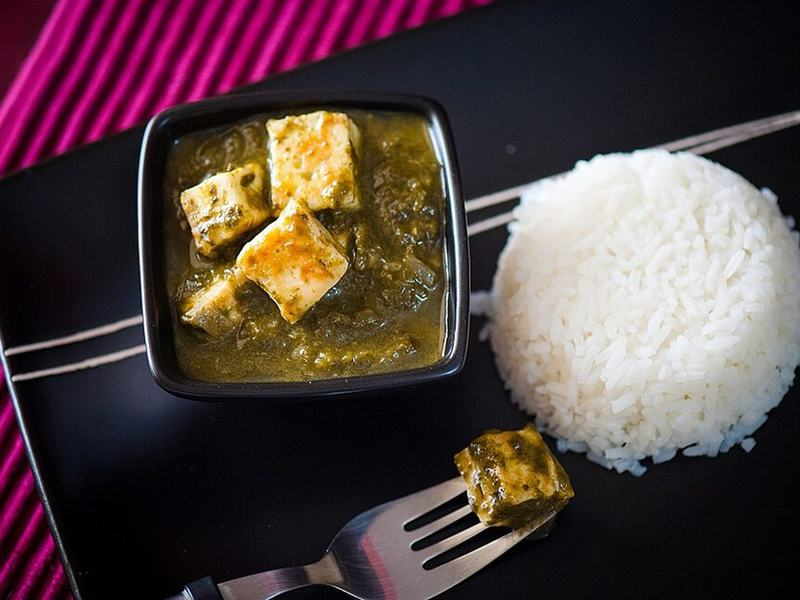

# Palak Paneer

Photo: Radhikamprabhu82 · CC BY-SA 4.0 · [source](https://commons.wikimedia.org/wiki/File:Cottage_cheese_in_spinach_gravy(palak_paneer).jpg)

**Dinner** · North Indian · 35 min · serves 4 · skill 2/3

> Golden pan-seared paneer cubes in a vivid, creamy spiced spinach sauce. Serve with naan or basmati.

| Per serving | kcal | Protein | Carbs | Fat | Fiber | Sodium | Cost |
| --- | --- | --- | --- | --- | --- | --- | --- |
| | 640 | 28 g | 42 g | 40 g | 6 g | 690 mg | $3.35 |

Contains: dairy, gluten

## Ingredients

- 14 oz paneer, cubed
- 1 lb spinach
- 1 onion
- 4 garlic cloves
- 1-inch ginger
- 1 green chili
- 1 tomato
- ¼ cup cream
- 2 tsp garam masala
- naan or rice

From the pantry: 2 tbsp butter or ghee, 1 tsp cumin, ½ tsp turmeric, salt

## Steps

1. Blanch the spinach 1 minute, plunge into ice water, then blend smooth with the chili and a splash of water.
2. Sear the paneer in 1 tbsp butter until golden on two sides. Set aside.
3. Cook the onion in the remaining butter until golden. Add the garlic, ginger, tomato and spices and cook 4 minutes.
4. Add the spinach purée and simmer gently 5 minutes. Season with salt.
5. Stir in the cream and paneer and warm through. Serve with naan.

**Tip:** Ice-bathing the spinach keeps the sauce bright green instead of army green.

## Storing

Fridge 3 days · freezer up to 2 months. Reheat gently on low. Add a splash of water or cream.

