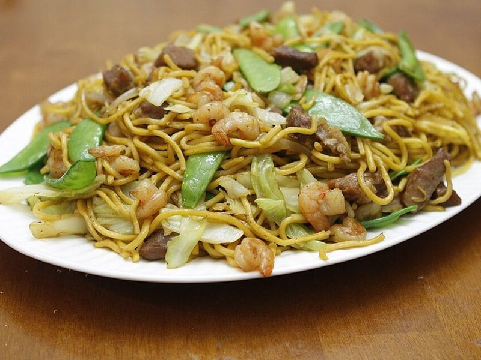

# Pancit Bihon with Chicken & Vegetables

Photo: pulaw · CC BY 2.0 · [source](https://commons.wikimedia.org/wiki/File:Pancit_Ilonggo_Style_-_12110747826.jpg)

**Lunch** · Filipino · 40 min · serves 4 · skill 2/3

> Thin rice noodles that soak up a savory chicken-and-soy broth until every strand is seasoned, tossed with cabbage, carrots and green beans. Squeeze lime over it, the way calamansi would be.

| Per serving | kcal | Protein | Carbs | Fat | Fiber | Sodium | Cost |
| --- | --- | --- | --- | --- | --- | --- | --- |
| | 540 | 31 g | 68 g | 16 g | 6 g | 1500 mg | $2.45 |

Contains: gluten

## Ingredients

- 8.8 oz rice vermicelli (bihon)
- 1 lb boneless chicken thighs, thinly sliced
- ½ lb cabbage, shredded
- 2 carrots, in thin matchsticks
- 4 oz green beans, thinly sliced on an angle
- 2 celery ribs with leaves, thinly sliced
- 1 onion, sliced
- 4 garlic cloves, minced
- ⅓ cup soy sauce
- 3 cups chicken broth
- 2 limes, in wedges

From the pantry: 3 tbsp oil, ½ tsp black pepper

## Steps

1. Soak the noodles in warm water for 10 minutes, then drain.
2. Heat the oil in a wok or large deep skillet over medium-high. Cook the onion and garlic until soft, 2 minutes, then add the chicken and stir-fry until browned, 4 to 5 minutes.
3. Add the broth and pepper and simmer 5 minutes. Add the carrots, green beans, cabbage and celery and simmer until crisp-tender, about 3 minutes. Lift the chicken and vegetables out with a slotted spoon, leaving the broth.
4. Stir the soy sauce into the broth, add the noodles and toss with tongs over medium heat until they absorb all the liquid and turn tender, 4 to 6 minutes.
5. Return the chicken and vegetables, toss for a minute to heat through, and serve with lime wedges.

**Tip:** Calamansi is traditional for squeezing over pancit; a mix of lime and a little orange juice is the closest supermarket match. Snow peas are a classic addition if you have them.

Adapted from [Panlasang Pinoy](https://panlasangpinoy.com/pancit-guisado/).

## Storing

Fridge 4 days · freezer not recommended. Microwave with a splash of broth or water, covered, 1½ to 2 minutes.

