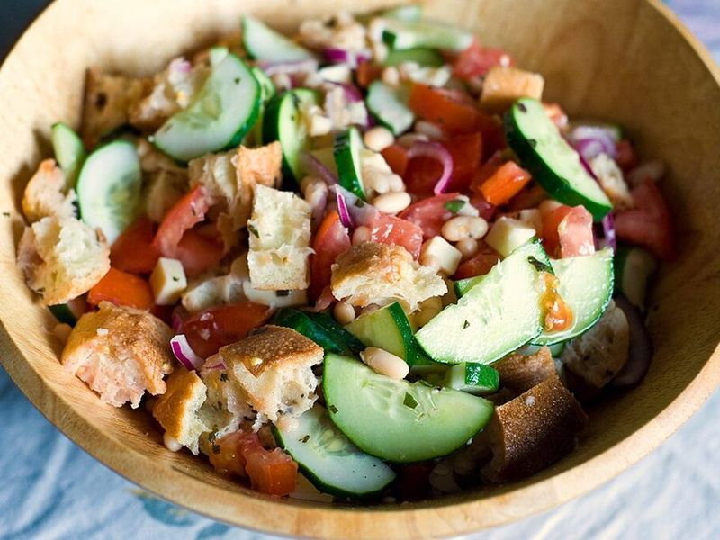

# Tuscan Panzanella with Mozzarella & White Beans

Photo: Heather Katsoulis · CC BY-SA 2.0 · [source](https://commons.wikimedia.org/wiki/File:Italian_Panzanella.jpg)

**Lunch** · Italian · 40 min · serves 4 · skill 1/3

> Juicy summer tomatoes, crisp cucumber and basil tossed with oven-toasted bread that soaks up a tangy tomato-juice vinaigrette, made into a full lunch with mozzarella and cannellini beans.

| Per serving | kcal | Protein | Carbs | Fat | Fiber | Sodium | Cost |
| --- | --- | --- | --- | --- | --- | --- | --- |
| | 695 | 28 g | 74 g | 34 g | 9 g | 1080 mg | $2.86 |

Contains: gluten, dairy

## Ingredients

- 8 oz day-old sourdough, torn into 1-inch chunks
- 2 lb ripe tomatoes, cut into wedges
- 1 English cucumber, in chunks
- ¼ onion, very thinly sliced and rinsed
- 1 cup basil leaves
- 1 can cannellini beans, rinsed
- 8 oz fresh mozzarella pearls
- 1 large garlic clove, finely grated

From the pantry: 9 tbsp olive oil, 2 tbsp red wine vinegar, 1 tsp Dijon mustard, 1¼ tsp salt, pepper

## Steps

1. Heat the oven to 350°F. Toss the bread with 1 tbsp of the oil, spread on a sheet pan and toast until golden and crunchy outside but still a little soft inside, about 15 minutes. Let it cool.
2. Put the tomato wedges in a colander set over a large bowl, sprinkle with 1 tsp salt, toss, and leave 10 minutes so the juices drip into the bowl.
3. Whisk the vinegar, mustard, garlic, remaining salt, some pepper and the rest of the oil into the tomato juice in the bowl to make the dressing.
4. Add the tomatoes, cucumber, onion, beans, mozzarella and basil to the dressing, then the bread, and toss gently.
5. Let it sit 5 to 10 minutes, tossing once or twice, so the bread drinks up the juices before serving.

**Tip:** The salted-tomato juice is the secret: it turns into a dressing with real tomato flavor. Use the ripest tomatoes you can find, even if they are a little soft.

Adapted from [RecipeTin Eats](https://www.recipetineats.com/panzanella/).

## Storing

Fridge 1 days · freezer not recommended. Best eaten the day it's made. Store the toasted bread separately if prepping ahead and toss together just before eating.

