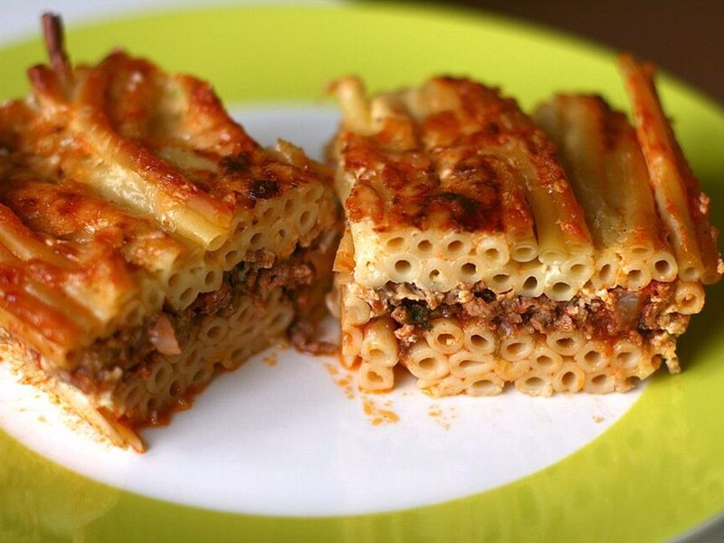

# Pastitsio (Greek Baked Pasta with Cinnamon Beef & Béchamel)

Photo: Katrin Morenz from Aachen, Deutschland · CC BY-SA 2.0 · [source](https://commons.wikimedia.org/wiki/File:Greek_pastitsio.jpg)

**Dinner** · Greek · 120 min · serves 6 · skill 3/3

> Greece's answer to lasagna: a layer of tubular pasta bound with feta, a thick beef sauce warmed with cinnamon and cloves, and a deep, golden cheese béchamel on top. A crowd-pleasing Sunday bake.

| Per serving | kcal | Protein | Carbs | Fat | Fiber | Sodium | Cost |
| --- | --- | --- | --- | --- | --- | --- | --- |
| | 910 | 44 g | 65 g | 52 g | 4 g | 1120 mg | $2.65 |

Contains: gluten, dairy, egg, beef

## Ingredients

- 1½ lb ground beef
- 1 large onion, finely chopped
- 3 garlic cloves, minced
- 21 oz crushed tomatoes (¾ of a 28 oz can)
- 12 oz ziti, penne or bucatini
- 5 tbsp butter
- 3 cups milk
- 5 oz grated Parmesan, divided
- 2 eggs, separated
- 3 oz feta, crumbled

From the pantry: 2 tbsp olive oil, ½ cup flour, ½ cup dry red wine, 2 tbsp tomato paste, 1 tsp cinnamon, ¼ tsp ground cloves, ¼ tsp nutmeg, 1 tsp sugar, 1 bay leaf, salt, pepper

## Steps

1. Heat the oil in a large pot over medium-high and cook the onion and garlic 3 minutes. Add the beef and cook, breaking it up, until browned. Add the wine and cook until mostly evaporated.
2. Stir in the tomatoes, tomato paste, cinnamon, cloves, sugar, bay leaf, 1 tsp salt and pepper. Simmer gently, uncovered, 40 to 45 minutes until thick with little liquid left. Let cool a bit.
3. For the béchamel, melt the butter over medium, whisk in the flour for 1 minute, then slowly whisk in the milk. Cook, stirring, until thick enough to coat a spoon heavily, about 5 minutes. Off the heat stir in the nutmeg, half the Parmesan and ½ tsp salt; cool 5 minutes, then whisk in the egg yolks.
4. Heat the oven to 350°F. Cook the pasta 1 minute short of the package time and drain. Cool 3 minutes, then stir in the egg whites, feta and a handful of Parmesan.
5. Spread the pasta in a 9x13-inch dish, top with the meat sauce, then pour over the béchamel and sprinkle with the remaining Parmesan.
6. Bake until deep golden, 35 to 40 minutes. Rest at least 15 minutes before cutting into squares.

**Tip:** Kefalotyri is the traditional Greek cheese for pastitsio; Pecorino Romano is the closest supermarket swap if you want more bite than Parmesan.

Adapted from [RecipeTin Eats](https://www.recipetineats.com/pastitsio-greek-beef-pasta-bake/).

## Storing

Fridge 5 days · freezer up to 3 months. Freeze individual squares. Reheat covered at 350°F for 20 to 25 minutes, or microwave a portion 2 to 3 minutes.

