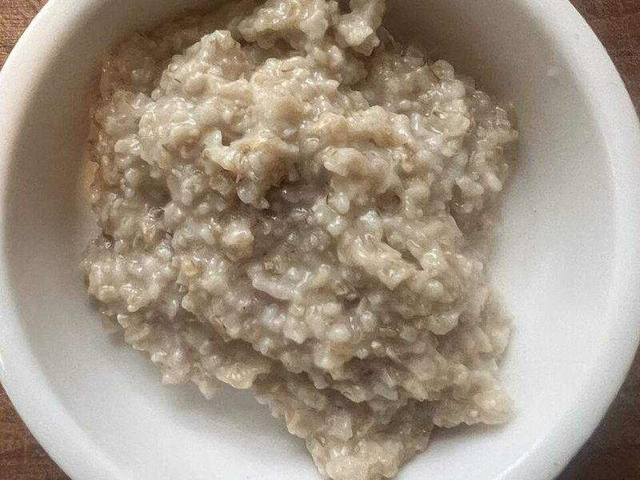

# Peanut Butter Banana Oatmeal

Photo: Acsenray · CC0 · [source](https://commons.wikimedia.org/wiki/File:Cooked_steel-cut_oats.jpg)

**Breakfast** · American comfort · 10 min · serves 4 · skill 1/3

> Creamy stovetop oats stirred with mashed banana and finished with a swirl of peanut butter, sliced banana and chia.

| Per serving | kcal | Protein | Carbs | Fat | Fiber | Sodium | Cost |
| --- | --- | --- | --- | --- | --- | --- | --- |
| | 490 | 19 g | 69 g | 18 g | 9 g | 480 mg | $0.67 |

Contains: dairy, nuts, gluten

## Ingredients

- 2 cups rolled oats
- 2 cups milk (plus 1½ cups water)
- 3 bananas
- ¼ cup peanut butter
- 1 tbsp honey
- 1 tbsp chia seeds

From the pantry: Pinch of salt, cinnamon

## Steps

1. Bring the milk, 1½ cups water and a pinch of salt to a simmer.
2. Stir in the oats and cook, stirring now and then, 5 minutes, until creamy.
3. Mash 1 banana and stir it in with a pinch of cinnamon.
4. Divide among bowls. Top with the remaining banana, sliced.
5. Finish with a spoon of peanut butter, a drizzle of honey and the chia seeds.

**Tip:** Warm the peanut butter for 10 seconds in the microwave so it drizzles.

## Storing

Fridge 4 days · freezer up to 2 months. Portion into containers. Add a splash of milk and microwave 1½ minutes.

