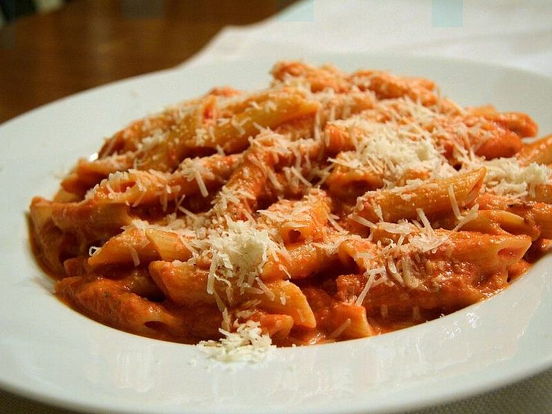

# Creamy Penne alla Vodka

Photo: Joseph O'Connell - https://www.flickr.com/photos/joconnell/ · CC BY-SA 2.0 · [source](https://commons.wikimedia.org/wiki/File:PenneAllaVodka.jpg)

**Dinner** · Italian · 30 min · serves 4 · skill 1/3

> Penne in a blushing, velvety tomato cream sauce with a gentle chili kick and plenty of Parmesan. The vodka is optional, but it sharpens the tomato flavor.

| Per serving | kcal | Protein | Carbs | Fat | Fiber | Sodium | Cost |
| --- | --- | --- | --- | --- | --- | --- | --- |
| | 740 | 22 g | 96 g | 31 g | 6 g | 760 mg | $1.68 |

Contains: gluten, dairy

## Ingredients

- 1 lb penne
- 1 (14 oz) can crushed tomatoes (half a 28 oz can)
- ¾ cup heavy cream
- ½ onion, finely diced
- 3 garlic cloves, minced
- 2 tbsp butter
- ⅔ cup grated Parmesan
- fresh basil

From the pantry: 1 tbsp olive oil, 3 tbsp tomato paste, ¼ cup vodka (optional), ½ tsp red pepper flakes, 1 tsp salt

## Steps

1. Bring a large pot of salted water to a boil. Melt the butter with the oil in a large skillet over medium and cook the onion until soft, 4 to 5 minutes. Add the garlic and pepper flakes for 1 minute.
2. Stir in the tomato paste and cook, stirring, until it darkens to brick red, 2 to 3 minutes. Add the vodka if using and simmer until it smells less boozy, 1 to 2 minutes.
3. Add the crushed tomatoes and simmer 5 minutes, then stir in the cream and keep warm over low.
4. Cook the penne until just shy of al dente. Scoop out 1 cup of the pasta water, then drain.
5. Toss the penne into the sauce with the Parmesan and splashes of pasta water over medium heat until glossy and clinging, 1 to 2 minutes. Serve with torn basil and more cheese.

**Tip:** Browning the tomato paste well is what gives this its deep, sweet flavor, so don't rush that step.

## Storing

Fridge 3 days · freezer not recommended. Add a splash of water or milk and microwave covered 1½ to 2 minutes, stirring halfway.

