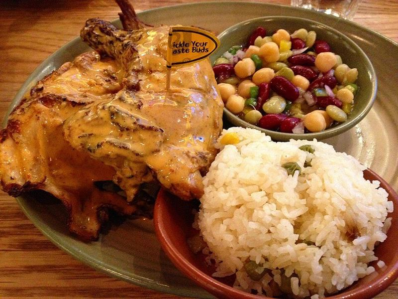

# Peri-Peri Chicken Wraps with Garlic Yogurt

Photo: Banej · CC BY-SA 4.0 · [source](https://commons.wikimedia.org/wiki/File:Flame-grilled_PERi-PERi_chicken.jpg)

**Lunch** · African · 30 min · serves 4 · skill 1/3

> Fiery, tangy peri-peri chicken with charred edges, rolled up with crisp lettuce, tomato and a cooling garlic yogurt sauce. A Mozambican-Portuguese favorite in a lunchbox-friendly wrap.

| Per serving | kcal | Protein | Carbs | Fat | Fiber | Sodium | Cost |
| --- | --- | --- | --- | --- | --- | --- | --- |
| | 480 | 44 g | 34 g | 19 g | 4 g | 1320 mg | $2.74 |

Contains: gluten, dairy, spicy

## Ingredients

- 1½ lb boneless chicken thighs
- 6 tbsp peri-peri sauce, divided
- 4 large flour tortillas
- 1 romaine heart, shredded
- 2 Roma tomatoes, sliced
- ¼ red onion, thinly sliced
- ¾ cup plain Greek yogurt
- 1 lemon
- 2 garlic cloves, grated

From the pantry: 2 tbsp oil, 1 tsp smoked paprika, 1 tsp dried oregano, 1 tsp salt

## Steps

1. Toss the chicken with 4 tbsp peri-peri sauce, 1 tbsp oil, the paprika, oregano, the lemon zest and ½ tsp salt. Marinate at least 15 minutes, or up to overnight.
2. Stir the yogurt with half the garlic, a squeeze of lemon and a pinch of salt.
3. Cook the chicken in the remaining oil in a skillet or grill pan over medium-high heat until charred and 165°F inside, 5 to 6 minutes per side. Rest 5 minutes, slice, and toss with the remaining 2 tbsp peri-peri sauce.
4. Warm the tortillas in a dry skillet for 20 seconds per side so they bend without cracking.
5. Spread each tortilla with garlic yogurt, top with lettuce, tomato, onion and chicken, then fold in the sides and roll up tightly. Cut in half to serve.

**Tip:** Toss the cooked chicken in fresh sauce. The marinade's heat mellows on the stove, and the final toss brings back the bright, vinegary kick.

## Storing

Fridge 3 days · freezer up to 2 months. Store the chicken separately from the vegetables and sauce. Warm the chicken for 1 minute in the microwave, then build the wrap. Wraps made ahead keep 1 day.

## Other ways to make it

- Steak
- Shrimp
- Pork
- Tofu
