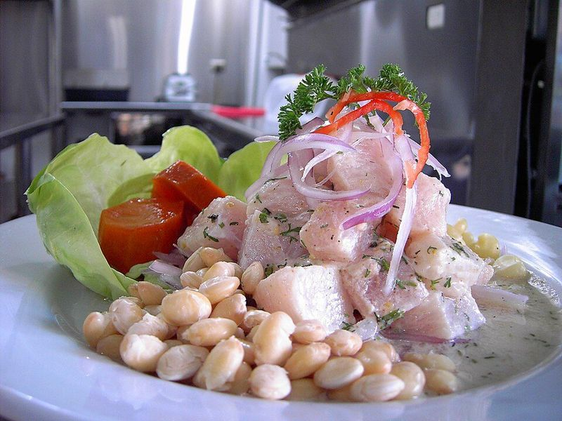

# Peruvian Ceviche with Sweet Potato & Corn

Photo: Picanteria karol · CC BY-SA 4.0 · [source](https://commons.wikimedia.org/wiki/File:Cebiche_de_corvina.JPG)

**Lunch** · Peruvian · 45 min · serves 4 · skill 2/3

> Bright, lime-cured cubes of white fish with red onion, chili and cilantro, served the Lima way with sweet potato and corn to soak up the tangy leche de tigre.

| Per serving | kcal | Protein | Carbs | Fat | Fiber | Sodium | Cost |
| --- | --- | --- | --- | --- | --- | --- | --- |
| | 485 | 49 g | 70 g | 3 g | 11 g | 530 mg | $4.82 |

Contains: fish, spicy

## Ingredients

- 2 lb very fresh skinless cod or other firm white fish
- 1 lb limes (about 10), juiced
- 1 red onion, very thinly sliced
- 2 garlic cloves, grated
- 1-inch piece ginger, grated
- 1 jalapeño, seeded and minced
- ½ bunch cilantro, chopped
- 1½ lb sweet potatoes
- 12 oz corn kernels (or 2 ears)
- 1 head butter lettuce

From the pantry: 1 tsp salt, ¼ tsp pepper, 4 ice cubes

## Steps

1. Boil the whole sweet potatoes in salted water until tender, 25 to 30 minutes. Cool, peel and slice into thick rounds. Cook the corn in boiling water for 3 minutes and drain.
2. Soak the sliced onion in ice water for 10 minutes to tame it, then drain well.
3. Cut the fish into ¾-inch cubes, put them in a chilled glass bowl, season with the salt and toss. Add the garlic, ginger and jalapeño.
4. Pour the lime juice over the fish with the ice cubes and stir gently. Leave in the fridge for 10 to 15 minutes, until the outside of the cubes turns opaque but the centers stay slightly translucent.
5. Remove the ice, fold in the onion and cilantro, and taste for salt.
6. Spoon the ceviche and its juice onto lettuce leaves, with sweet potato and corn on the side. Eat right away.

**Tip:** Use only fish you'd be happy to eat raw, ask the counter for their freshest. In Peru the chili is ají limo; a pinch of ají amarillo paste stirred into the lime juice gets you closer.

Adapted from [196 flavors](https://www.196flavors.com/peru-ceviche/).

## Storing

Fridge 0 days · freezer not recommended. Best eaten within an hour of making; don't store leftovers.

