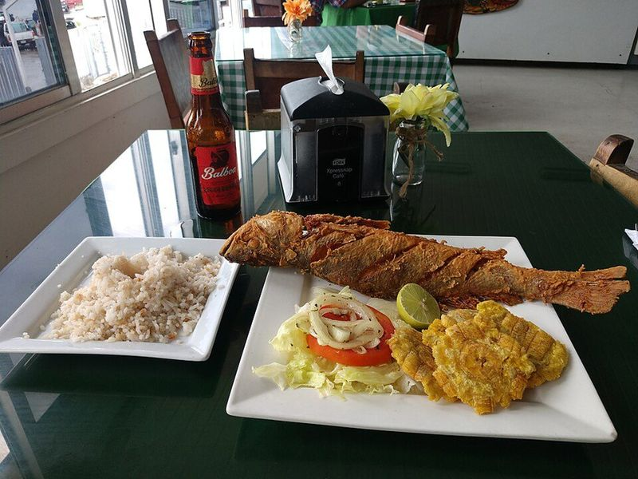

# Cartagena Fried Fish with Coconut Rice & Patacones

Photo: ProtoplasmaKid · CC BY-SA 4.0 · [source](https://commons.wikimedia.org/wiki/File:Arroz_con_coco,_pescado_frito_y_patacones.jpg)

**Dinner** · Colombian · 50 min · serves 4 · skill 2/3

> A Caribbean-coast feast: lime and scallion fish fried until crisp, with sweet, nutty coconut rice, smashed green-plantain patacones and a quick tomato-onion salad.

| Per serving | kcal | Protein | Carbs | Fat | Fiber | Sodium | Cost |
| --- | --- | --- | --- | --- | --- | --- | --- |
| | 890 | 41 g | 104 g | 37 g | 5 g | 420 mg | $3.46 |

Contains: fish, gluten

## Ingredients

- 1½ lb tilapia or snapper fillets (or 2 small whole fish)
- 2 limes
- 4 scallions, finely chopped
- 1⅔ cups long-grain white rice
- 1 (13.5 oz) can coconut milk
- 2 green plantains
- 2 plum tomatoes, diced
- ¼ white onion, finely diced
- a handful of cilantro, chopped

From the pantry: ¼ cup flour for dredging, oil for frying, 2 tbsp sugar, salt, pepper

## Steps

1. Make the coconut rice: combine the rice, coconut milk, 1 cup water, the sugar and 1 tsp salt in a pot. Boil, stir once, cover and cook on low for 20 minutes, then rest 5 minutes covered.
2. Season the fish with salt and pepper, rub with the scallions and juice of 1 lime, and let it sit 10 minutes. Toss the tomatoes, onion and cilantro with a squeeze of lime and a pinch of salt for the salad.
3. Peel the plantains and cut into 1½-inch pieces. Heat ½ inch of oil in a large skillet to 350°F and fry until pale gold and tender, 3 to 4 minutes per side. Smash each one flat with the bottom of a glass, then fry again until crisp, 1 to 2 minutes per side. Salt them.
4. Dredge the fish lightly in flour and fry in the same oil over medium-high until golden and it flakes, 3 to 4 minutes per side. Drain.
5. Serve the fish with the coconut rice, patacones, tomato salad and lime wedges.

**Tip:** On the coast the rice is made by cooking down fresh coconut until it caramelizes, which makes it brown and sweet. To get closer, simmer the coconut milk alone until it browns and separates before adding the rice.

Adapted from [My Colombian Recipes](https://www.mycolombianrecipes.com/pescado-frito-colombiano-colombian-style-fried-whole-fish/).

## Storing

Fridge 2 days · freezer not recommended. Best fresh. Refrigerate leftovers and re-crisp the fish and patacones in a 400°F oven or air fryer.

