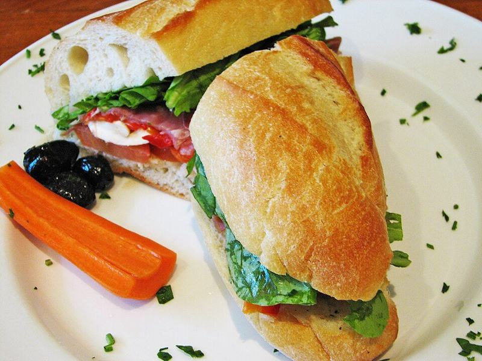

# Pesto Chicken & Mozzarella Panini

Photo: Unknown · CC BY-SA 2.5 · [source](https://commons.wikimedia.org/wiki/File:Italian_Sandwich.jpeg)

**Lunch** · Italian · 30 min · serves 4 · skill 1/3

> Golden, pressed sourdough with juicy sliced chicken, basil pesto, gooey mozzarella, tomato and spinach. Crisp outside, melty inside.

| Per serving | kcal | Protein | Carbs | Fat | Fiber | Sodium | Cost |
| --- | --- | --- | --- | --- | --- | --- | --- |
| | 605 | 43 g | 48 g | 26 g | 3 g | 1230 mg | $2.06 |

Contains: gluten, dairy, nuts

## Ingredients

- 1 lb chicken breasts
- ⅓ cup basil pesto
- 1 cup shredded mozzarella
- 8 slices sourdough bread
- 1 large Roma tomato, thinly sliced
- a big handful of baby spinach

From the pantry: 2 tbsp butter, 1 tbsp oil, ½ tsp Italian seasoning, salt, pepper

## Steps

1. Slice the chicken breasts in half horizontally into thin cutlets and season with Italian seasoning, salt and pepper.
2. Heat the oil in a skillet over medium-high and cook the cutlets until golden and 165°F inside, 3 to 4 minutes per side. Rest 5 minutes, then slice thin.
3. Spread pesto on one side of each bread slice. On 4 slices, layer mozzarella, spinach, chicken, tomato and a little more mozzarella, then close with the remaining slices, pesto side in.
4. Butter the outsides of the sandwiches. Cook in a panini press, or in a skillet over medium-low with a heavy pan on top, until deep golden and the cheese melts, 3 to 4 minutes per side.
5. Rest 1 minute, then slice in half and serve.

**Tip:** Keep the heat at medium-low so the cheese melts before the bread gets too dark.

## Storing

Fridge 2 days · freezer not recommended. Refrigerate wrapped. Re-crisp in a skillet or a 375°F oven for 8 to 10 minutes.

## Other ways to make it

- Steak
- Shrimp
- Pork
- Tofu
