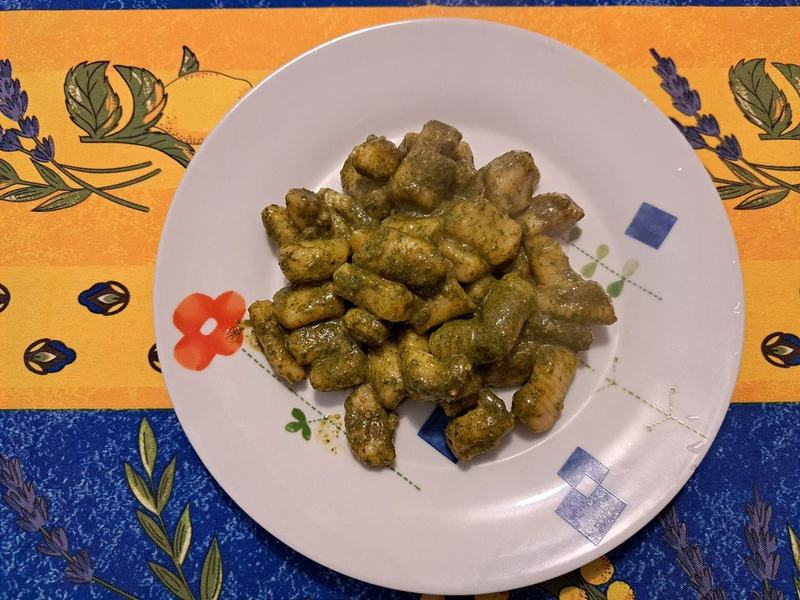

# Pesto Gnocchi with Sausage & Blistered Tomatoes

Photo: Postcrosser · CC BY-SA 4.0 · [source](https://commons.wikimedia.org/wiki/File:Gnocchi_al_pesto_02.jpg)

**Dinner** · Italian · 20 min · serves 4 · skill 1/3

> Shelf-stable gnocchi pan-fried until crisp, tossed with browned sausage, burst cherry tomatoes and basil pesto. Dinner in twenty minutes.

| Per serving | kcal | Protein | Carbs | Fat | Fiber | Sodium | Cost |
| --- | --- | --- | --- | --- | --- | --- | --- |
| | 775 | 27 g | 47 g | 53 g | 3 g | 2170 mg | $2.94 |

Contains: pork, dairy, gluten, nuts

## Ingredients

- 1 package (16 to 17.6 oz) shelf-stable potato gnocchi
- 12 to 16 oz Italian sausage, sliced or casings removed
- 1 pint cherry tomatoes
- ½ cup basil pesto
- 2 handfuls baby spinach
- Parmesan, for shaving

From the pantry: 2 tbsp olive oil, salt, pepper

## Steps

1. Heat 1 tbsp oil in a large nonstick skillet over medium-high. Add the gnocchi straight from the package in one layer and leave them alone for 3 minutes, until golden underneath. Toss and cook 3 minutes more, then tip into a bowl.
2. Add the remaining oil and the sausage. Brown, breaking it up or turning the slices, 5 to 6 minutes.
3. Add the tomatoes and a pinch of salt. Cook until they blister and some burst, about 4 minutes. Press a few to release their juices.
4. Return the gnocchi, add the spinach and pesto with a splash of water and toss until glossy.
5. Finish with shaved Parmesan and black pepper.

**Tip:** Don't boil shelf-stable gnocchi first. Pan-frying from raw is what makes them crisp outside and fluffy inside.

## Storing

Fridge 3 days · freezer not recommended. Gnocchi softens in the fridge. Reheat in a skillet over medium with a splash of water until hot, 3 to 5 minutes.

## Other ways to make it

- Ground beef
- Ground turkey
- Ground pork
- Lentils (veg)
