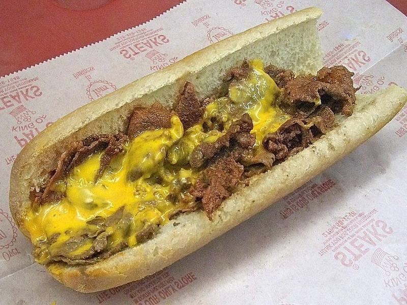

# Philly Cheesesteaks with Melty Provolone

Photo: Unknown · CC BY-SA 3.0 · [source](https://commons.wikimedia.org/wiki/File:PatsCheesesteak.jpg)

**Lunch** · American comfort · 25 min · serves 4 · skill 1/3

> Thin-shaved steak seared hard on a hot griddle with sweet onions and peppers, blanketed in provolone and scooped into toasted hoagie rolls.

| Per serving | kcal | Protein | Carbs | Fat | Fiber | Sodium | Cost |
| --- | --- | --- | --- | --- | --- | --- | --- |
| | 675 | 40 g | 56 g | 32 g | 4 g | 1020 mg | $3.34 |

Contains: gluten, dairy, beef

## Ingredients

- 1 lb shaved beef steak
- 4 hoagie rolls
- 8 thin slices provolone
- 2 onions, thinly sliced
- 1 green or red bell pepper, thinly sliced

From the pantry: 2 tbsp oil, 1 tsp Worcestershire sauce, ½ tsp garlic powder, salt, pepper

## Steps

1. Heat 1 tbsp oil in a large skillet over medium heat. Cook the onions and pepper with a pinch of salt, stirring, until soft and lightly browned, 10 to 12 minutes. Scoop them out.
2. Split the rolls without cutting all the way through and toast them cut side down in the pan or under the broiler until golden, 1 to 2 minutes.
3. Raise the heat to high and add the remaining oil. Add the beef in a thin layer and season with salt, pepper and garlic powder. Sear without moving for 1 minute, then chop and toss with a spatula until no pink remains, 2 to 3 minutes. Stir in the Worcestershire.
4. Return the onions and peppers, split everything into 4 long piles in the pan and lay 2 slices of provolone on each. Turn off the heat and cover until the cheese melts, about 1 minute.
5. Slide a spatula under each pile and flip it into a toasted roll. Serve right away.

**Tip:** If your steak isn't pre-shaved, freeze a ribeye for 30 minutes and slice it paper-thin against the grain.

## Storing

Fridge 2 days · freezer not recommended. Wrap in foil and reheat in a 350°F oven for 10 to 12 minutes.

## Other ways to make it

- Chicken
- Shrimp
- Pork
- Tofu
