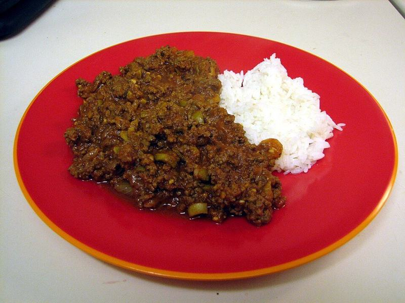

# Cuban Picadillo

Photo: Cary Bass · CC BY-SA 3.0 · [source](https://commons.wikimedia.org/wiki/File:Picadillo_and_rice.jpg)

**Dinner** · Caribbean & Latin · 35 min · serves 4 · skill 1/3

> Savory-sweet ground beef simmered with tomatoes, potatoes, olives and warm spices. Spoon over white rice with fried plantains.

| Per serving | kcal | Protein | Carbs | Fat | Fiber | Sodium | Cost |
| --- | --- | --- | --- | --- | --- | --- | --- |
| | 820 | 35 g | 78 g | 41 g | 7 g | 970 mg | $3.49 |

Contains: beef

## Ingredients

- 1⅓ lb ground beef
- 1 onion
- 1 green pepper
- 4 garlic cloves
- 14 oz tomato sauce
- 12 oz potatoes, small dice
- ⅓ cup green olives
- 1½ cups rice

From the pantry: 2 tbsp oil, 1 tsp cumin, 1 tsp oregano, ¼ cup raisins (optional), 1 tbsp vinegar, salt

## Steps

1. Fry the diced potatoes in the oil until golden, 8 minutes. Remove. Start the rice.
2. Brown the beef with the onion, pepper and garlic, breaking it up, 8 minutes.
3. Add the spices, tomato sauce, raisins, vinegar and ½ cup water. Simmer 10 minutes.
4. Stir in the potatoes and olives and simmer 5 more minutes.
5. Serve over rice.

**Tip:** Picadillo makes great empanada, taco or stuffed-pepper filling too.

## Storing

Fridge 5 days · freezer up to 3 months. Microwave covered, 1½ to 2 minutes, stirring halfway.

## Other ways to make it

- Ground turkey
- Ground pork
- Italian sausage
- Lentils (veg)
