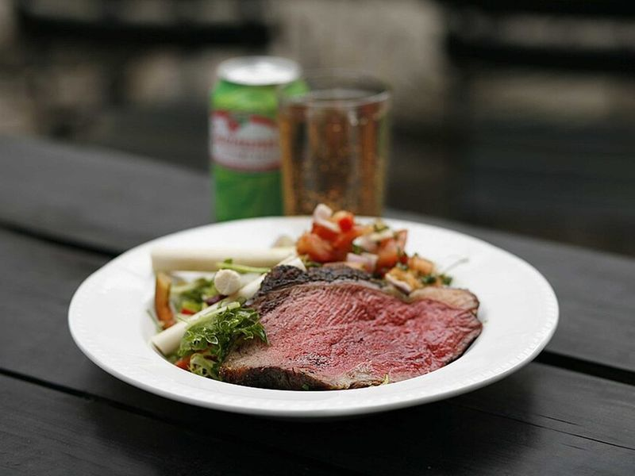

# Brazilian Picanha with Farofa & Vinagrete

Photo: Sepato · CC BY 3.0 · [source](https://commons.wikimedia.org/wiki/File:Picanha_brazil.JPG)

**Dinner** · Brazilian · 50 min · serves 5 · skill 2/3

> Churrascaria night at home: thick slices of salt-crusted sirloin broiled until charred and pink, served with buttery farofa, rice and a fresh tomato-onion vinagrete.

| Per serving | kcal | Protein | Carbs | Fat | Fiber | Sodium | Cost |
| --- | --- | --- | --- | --- | --- | --- | --- |
| | 760 | 48 g | 77 g | 28 g | 5 g | 560 mg | $4.65 |

Contains: beef, dairy

## Ingredients

- 2 lb top sirloin (or picanha), 1½ inches thick
- 1⅓ cups farofa (toasted cassava flour)
- 2 tbsp butter
- 1 onion, finely diced
- 4 Roma tomatoes, finely diced
- 1 green bell pepper, finely diced
- ½ bunch parsley, chopped
- 1 lemon
- 1½ cups rice

From the pantry: 3 tbsp olive oil, 3 tbsp white vinegar, 2 tsp coarse salt, 1 tsp pepper

## Steps

1. Let the steak sit at room temperature for 30 minutes. Mix the tomatoes, three-quarters of the onion, the bell pepper and parsley with the olive oil, vinegar and a pinch of salt for the vinagrete, and chill. Start the rice.
2. Heat the broiler to high with a rack about 3 inches from the heat. Pat the steak dry and score any fat in a crosshatch. Season heavily on all sides with the coarse salt and pepper.
3. Broil on a rack set over a foil-lined sheet for 6 to 8 minutes, squeeze over the lemon, flip and broil 5 to 7 minutes more, to 130°F for medium-rare. Rest it under foil for 10 minutes.
4. Meanwhile melt the butter in a skillet over medium, soften the rest of the onion for 3 minutes, then stir in the farofa and toast until fragrant, 2 minutes.
5. Slice the steak thinly against the grain and serve with rice, farofa and plenty of vinagrete.

**Tip:** Ask the butcher for top sirloin cap (picanha) with the fat cap left on; it's the cut Brazilian steakhouses use. It's also excellent grilled over high heat.

Adapted from [Camila Made](https://camilamade.com/perfect-broiled-picanha/).

## Storing

Fridge 3 days · freezer up to 2 months. Keep the vinagrete separate; serve leftover steak cold or warm it briefly in a skillet.

