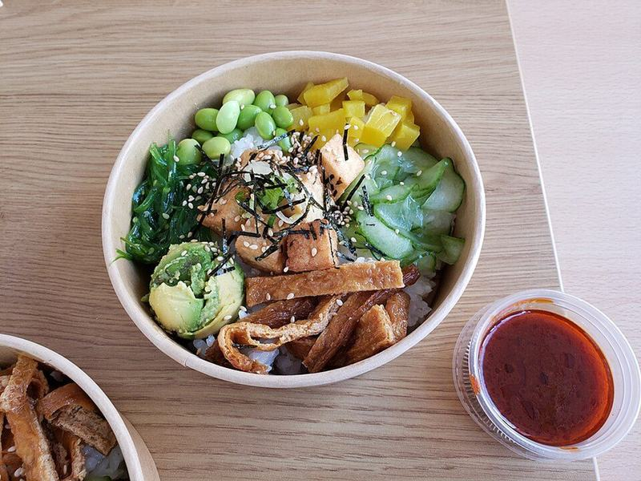

# Salmon or Ahi Poke Bowls

Photo: Andy Li · CC0 · [source](https://commons.wikimedia.org/wiki/File:Fried_Tofu_Poke_Bowl_(S)_with_kimchi_sauce_-_Kitokito.jpg)

**Lunch** · Hawaiian · 20 min · serves 4 · skill 1/3

> Cubes of sushi-grade fish tossed in soy, sesame and green onion over warm rice with avocado, edamame, cucumber and spicy mayo.

| Per serving | kcal | Protein | Carbs | Fat | Fiber | Sodium | Cost |
| --- | --- | --- | --- | --- | --- | --- | --- |
| | 690 | 40 g | 62 g | 32 g | 9 g | 860 mg | $5.26 |

Contains: fish, gluten, sesame

## Ingredients

- 1 lb sushi-grade ahi or salmon, cubed
- ¼ cup soy sauce
- 4 green onions
- 1½ cups sushi or jasmine rice
- 2 avocados
- 1 cup edamame
- 1 cucumber
- sesame seeds

From the pantry: 1 tbsp sesame oil, 2 tbsp rice vinegar, 1 tsp sugar, ⅓ cup mayo, 1 tbsp sriracha

## Steps

1. Cook the rice and season with the vinegar, sugar and a pinch of salt.
2. Toss the fish with the soy, sesame oil, green onions and sesame. Chill 10 minutes.
3. Stir the mayo and sriracha together.
4. Cook the edamame. Slice the cucumber and avocado.
5. Build bowls: rice, poke, avocado, edamame and cucumber. Drizzle with spicy mayo.

**Tip:** Buy fish labeled sushi- or sashimi-grade and eat it the same day.

## Storing

Fridge 1 days · freezer not recommended. Eat poke within 24 hours. Keep it very cold.

