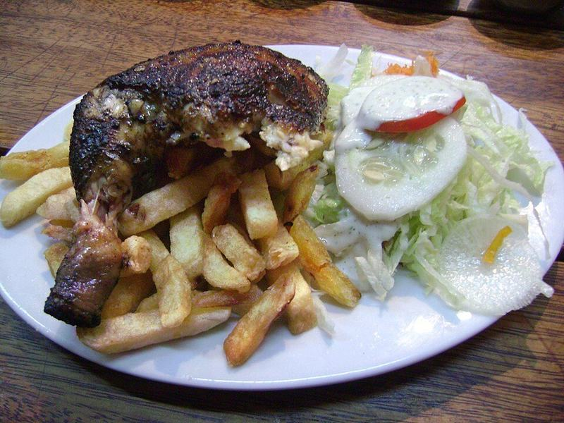

# Peruvian Roast Chicken (Pollo a la Brasa) with Green Sauce

Photo: Dtarazona · CC BY-SA 3.0 · [source](https://commons.wikimedia.org/wiki/File:Un_cuarto_de_Pollo_a_la_Brasa.JPG)

**Dinner** · Caribbean & Latin · 90 min · serves 5 · skill 2/3

> A whole chicken rubbed with garlic, cumin, lime and paprika and roasted until the skin crackles, served with crisp potato wedges and a creamy, spicy cilantro sauce you'll want on everything.

| Per serving | kcal | Protein | Carbs | Fat | Fiber | Sodium | Cost |
| --- | --- | --- | --- | --- | --- | --- | --- |
| | 850 | 51 g | 41 g | 54 g | 7 g | 910 mg | $2.41 |

Contains: gluten, dairy, egg, spicy

## Ingredients

- 1 whole chicken (about 4½ lb)
- 6 garlic cloves, divided
- 3 limes, divided
- 2 tbsp soy sauce
- 1 tbsp smoked paprika
- 2 lb russet potatoes, in wedges
- 1 bunch cilantro
- 2 jalapeños, seeded
- ½ cup feta or queso fresco
- 1 romaine heart, chopped, to serve

From the pantry: ⅓ cup mayo, 3 tbsp oil, 2 tsp ground cumin, 1 tsp dried oregano, 2 tsp salt, 1 tsp black pepper

## Steps

1. Blend 4 garlic cloves with the juice of 2 limes, the soy sauce, paprika, cumin, oregano, 1 tbsp oil, 1½ tsp salt and the pepper. Loosen the chicken skin and rub the paste under and over it. Marinate at least 1 hour or overnight in the fridge.
2. Heat the oven to 425°F. Set the chicken breast-side up on a rack over a sheet pan (or on the potatoes). Toss the wedges with the remaining oil and salt and spread them around it.
3. Roast until the skin is deep mahogany and the thickest part of the thigh reads 175°F, 65 to 75 minutes, turning the potatoes once.
4. While it roasts, blend the cilantro, jalapeños, remaining garlic, juice of 1 lime, the mayo and feta until smooth, adding a splash of water if needed.
5. Rest the chicken 10 minutes, then carve. Serve with the potatoes, the romaine and plenty of green sauce.

**Tip:** Marinating overnight makes a real difference, and drying the skin uncovered in the fridge gets it extra crisp.

## Storing

Fridge 4 days · freezer up to 3 months. Reheat chicken and potatoes uncovered at 375°F for 12 to 15 minutes. Keep the sauce cold; it lasts 4 days.

