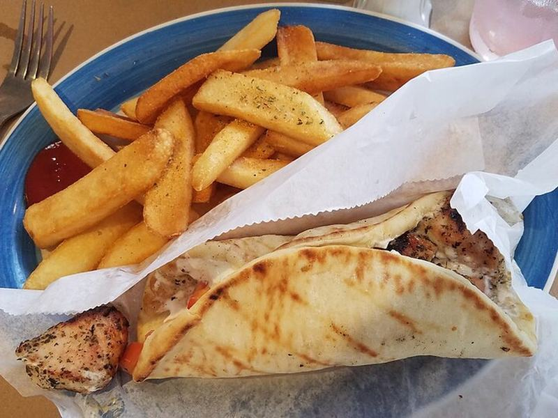

# Pork Souvlaki Pitas

Photo: Breawycker · CC BY-SA 4.0 · [source](https://commons.wikimedia.org/wiki/File:Chicken_souvlaki_pita_with_french_fries.jpg)

**Dinner** · Greek & Mediterranean · 35 min · serves 4 · skill 1/3

> Lemon-oregano marinated pork skewers grilled until charred, wrapped in warm pita with tzatziki, tomatoes, onion and fries or salad.

| Per serving | kcal | Protein | Carbs | Fat | Fiber | Sodium | Cost |
| --- | --- | --- | --- | --- | --- | --- | --- |
| | 580 | 40 g | 48 g | 26 g | 5 g | 960 mg | $3.26 |

Contains: dairy, gluten

## Ingredients

- 1¼ lb pork tenderloin, in 1-inch cubes
- 2 lemons
- 4 garlic cloves
- 4 pitas
- 12 oz tzatziki
- 2 tomatoes, sliced
- ½ red onion, sliced
- lettuce

From the pantry: ¼ cup olive oil, 1 tbsp dried oregano, 1 tsp paprika, salt, pepper

## Steps

1. Toss the pork with the oil, juice of 1 lemon, garlic, oregano, paprika, 1 tsp salt and pepper. Marinate 20 minutes or up to a day.
2. Thread onto skewers.
3. Grill or broil 10 to 12 minutes, turning, until charred and just cooked through.
4. Warm the pitas on the grill.
5. Fill pitas with pork, tzatziki, tomatoes, onion and lettuce. Squeeze over lemon.

**Tip:** Soak wooden skewers 20 minutes so they don't burn.

## Storing

Fridge 4 days · freezer up to 3 months. Reheat pork in a skillet. Build pitas fresh.

## Other ways to make it

- Chicken
- Steak
- Shrimp
- Tofu
