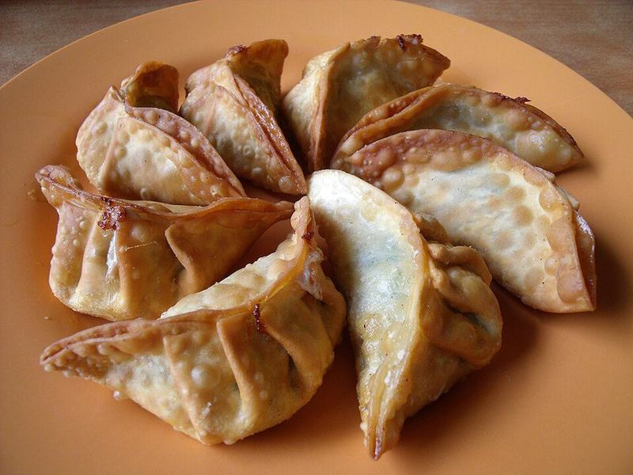

# Crispy Potsticker Stir-Fry with Chili Crisp

Photo: David · Public domain · [source](https://commons.wikimedia.org/wiki/File:FriedDumplings.JPG)

**Dinner** · Chinese · 15 min · serves 3 · skill 1/3

> Frozen dumplings pan-fried until their bottoms shatter, then tossed with stir-fry vegetables in a garlicky soy glaze and spooned with chili crisp. A 15-minute dinner.

| Per serving | kcal | Protein | Carbs | Fat | Fiber | Sodium | Cost |
| --- | --- | --- | --- | --- | --- | --- | --- |
| | 740 | 23 g | 78 g | 37 g | 8 g | 2090 mg | $2.81 |

Contains: pork, gluten, sesame, spicy

## Ingredients

- 24 oz frozen potstickers
- 16 oz frozen stir-fry vegetables
- 2 tbsp soy sauce
- 1 tbsp honey
- 2 garlic cloves
- chili crisp, to taste
- green onions

From the pantry: 2 tbsp oil, 1 tbsp rice vinegar

## Steps

1. Heat 1 tbsp oil in a large nonstick skillet over medium-high. Add the potstickers flat-side down and cook 2 minutes until golden.
2. Add ⅓ cup water, cover and steam 5 minutes, then uncover and let the water cook off so the bottoms re-crisp. Move to a plate.
3. Add the remaining oil and the vegetables to the pan and cook 4 minutes, until hot and lightly charred. Add the garlic.
4. Add the soy, honey and vinegar and toss until glossy, then return the potstickers.
5. Serve with chili crisp and green onions.

**Tip:** Leave the potstickers alone while they crisp. Moving them tears the bottoms.

## Storing

Fridge 3 days · freezer not recommended. Re-crisp in a skillet over medium, 3 to 4 minutes.

