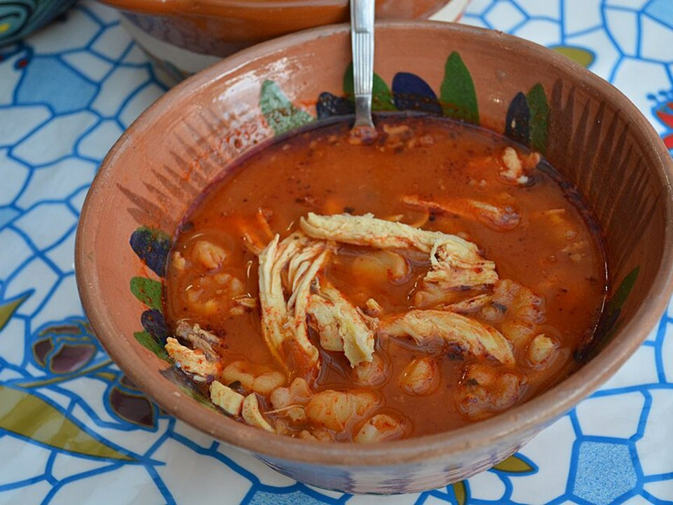

# Pozole Rojo

Photo: AlejandroLinaresGarcia · CC BY-SA 4.0 · [source](https://commons.wikimedia.org/wiki/File:2015EncuentroChilenero004.JPG)

**Dinner** · Mexican · 150 min · serves 6 · skill 2/3

> A celebratory Mexican stew of tender pork and chewy hominy in a brick-red chile broth, piled high with crunchy cabbage, radish, lime and oregano.

| Per serving | kcal | Protein | Carbs | Fat | Fiber | Sodium | Cost |
| --- | --- | --- | --- | --- | --- | --- | --- |
| | 670 | 33 g | 49 g | 37 g | 8 g | 2450 mg | $2.87 |

Contains: none of the tracked allergens

## Ingredients

- 2 lb pork shoulder, in chunks
- 2 cans hominy, drained
- 19 oz red enchilada sauce (or blended guajillo chiles)
- 6 cups broth
- 1 onion
- 6 garlic cloves
- shredded cabbage
- limes
- cilantro
- tostadas or chips

From the pantry: 1 tbsp oil, 2 tsp Mexican oregano, 1 tsp cumin, 2 bay leaves, salt

## Steps

1. Season the pork with salt and brown in the oil in a big pot.
2. Add the onion, garlic, broth, bay leaves and oregano. Simmer covered 1½ hours until the pork is tender.
3. Shred the pork right in the pot. Stir in the chile sauce, cumin and hominy.
4. Simmer 20 minutes more. Season well with salt.
5. Serve with cabbage, lime, cilantro, oregano and crunchy tostadas.

**Tip:** The toppings make pozole. Don't skip them.

## Storing

Fridge 5 days · freezer up to 4 months. Store toppings separately. Reheat on the stove over medium until simmering, or microwave 2 to 3 minutes, stirring once.

