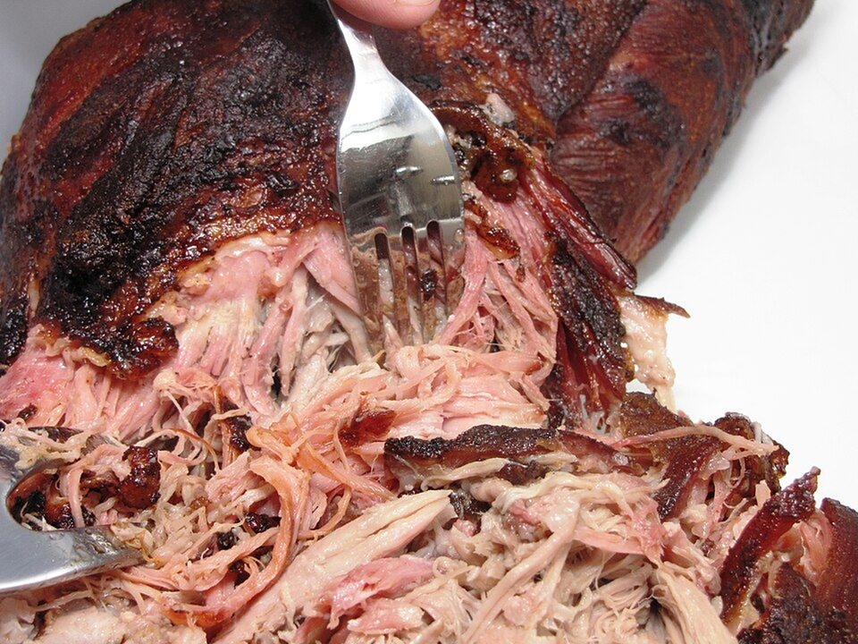

# BBQ Pulled Pork Sandwiches with Tangy Slaw

Photo: Thogru · CC BY-SA 3.0 · [source](https://commons.wikimedia.org/wiki/File:Pulled_pork_while_pulling.JPG)

**Dinner** · Southern & soul food · 240 min · serves 8 · skill 1/3

> Spice-rubbed pork shoulder cooked low and slow until it pulls apart, sauced with BBQ and piled on soft buns under crunchy vinegar slaw.

| Per serving | kcal | Protein | Carbs | Fat | Fiber | Sodium | Cost |
| --- | --- | --- | --- | --- | --- | --- | --- |
| | 855 | 37 g | 83 g | 41 g | 3 g | 1860 mg | $2.15 |

Contains: pork, gluten, egg

## Ingredients

- 3 lb boneless pork shoulder
- 1½ bottles BBQ sauce
- 1 onion, sliced
- 8 brioche buns
- 14 oz coleslaw mix
- pickles

From the pantry: Rub: 2 tbsp brown sugar, 1 tbsp smoked paprika, 2 tsp each salt, garlic powder, cumin. Slaw: ¼ cup mayo, 2 tbsp cider vinegar, 1 tsp sugar

## Steps

1. Rub the pork all over with the spice mix. Lay the onion in a slow cooker or Dutch oven, add the pork and ½ cup water.
2. Cook on low 8 hours, or covered at 300°F for 4 hours, until it shreds easily.
3. Shred the pork, discard excess fat and toss with 1 cup BBQ sauce and a ladle of the cooking juices.
4. Toss the slaw mix with the mayo, vinegar, sugar and a pinch of salt.
5. Pile pork on toasted buns with more sauce, slaw and pickles.

**Tip:** Spread sauced pork on a sheet pan and broil 3 minutes for crispy, bark-like edges.

## Storing

Fridge 5 days · freezer up to 4 months. Store pork with its juices. Reheat covered in the microwave or a pot. Keep slaw separate.

