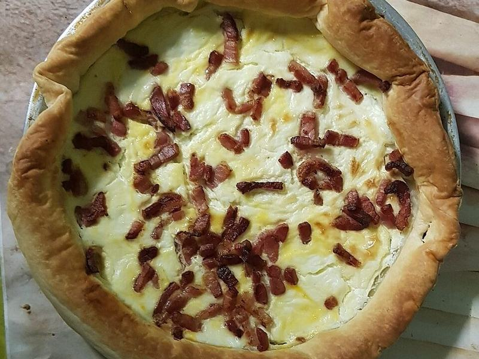

# Quiche Lorraine

Photo: Donna Alvita · CC BY-SA 4.0 · [source](https://commons.wikimedia.org/wiki/File:Quiche_de_Lorraine.jpg)

**Breakfast** · French · 75 min · serves 6 · skill 2/3

> A tall, silky custard of eggs, cream, smoky bacon and nutty Gruyère in a flaky crust. Brunch that reheats all week.

| Per serving | kcal | Protein | Carbs | Fat | Fiber | Sodium | Cost |
| --- | --- | --- | --- | --- | --- | --- | --- |
| | 640 | 26 g | 26 g | 48 g | 1 g | 930 mg | $2.55 |

Contains: egg, dairy, gluten, pork

## Ingredients

- 1 refrigerated pie crust
- 12 oz bacon, chopped
- 1 onion, diced
- 6 oz Gruyère, shredded
- 6 eggs
- 1 cup heavy cream
- ¾ cup milk

From the pantry: Nutmeg, salt, pepper

## Steps

1. Heat the oven to 375°F. Fit the crust into a 9-inch pie dish, prick all over, line with foil and weights and blind-bake 15 minutes. Remove the foil and bake 5 minutes more.
2. Cook the bacon until crisp and the onion in the bacon fat until soft.
3. Whisk the eggs, cream, milk, a pinch of nutmeg, ½ tsp salt and pepper.
4. Scatter bacon, onion and Gruyère in the crust and pour over the custard.
5. Lower the oven to 350°F and bake 35 to 40 minutes, until just set with a slight wobble in the center. Cool 15 minutes before slicing.

**Tip:** Pull it while the middle still jiggles. It sets as it cools and stays silky.

## Storing

Fridge 4 days · freezer up to 2 months. Reheat slices at 325°F for 10 minutes or microwave 45 seconds.

