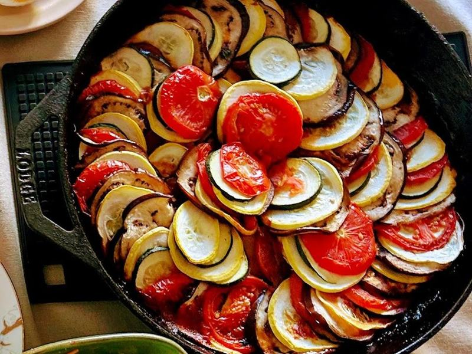

# Ratatouille with White Beans & Crusty Bread

Photo: Jack145945 · CC0 · [source](https://commons.wikimedia.org/wiki/File:Ratatouille_home_cooked.jpg)

**Dinner** · French · 75 min · serves 4 · skill 2/3

> A Provençal summer stew of eggplant, zucchini, peppers and tomatoes, each browned in olive oil then simmered with garlic and herbs until silky, with creamy white beans and warm bread for scooping.

| Per serving | kcal | Protein | Carbs | Fat | Fiber | Sodium | Cost |
| --- | --- | --- | --- | --- | --- | --- | --- |
| | 665 | 26 g | 102 g | 21 g | 22 g | 1340 mg | $3.45 |

Contains: gluten

## Ingredients

- 1 large eggplant, in ¾-inch cubes
- 3 zucchini, in ¾-inch chunks
- 2 red or yellow bell peppers, chopped
- 1 onion, chopped
- 5 garlic cloves, minced
- 4 Roma tomatoes, chopped
- 1 (14 oz) can crushed tomatoes (half a 28 oz can)
- 2 cans cannellini beans, drained
- fresh basil, torn
- 1 baguette, warmed

From the pantry: ½ cup olive oil, 2 tsp herbes de Provence (or dried thyme), 1 tsp red wine vinegar, 2 tsp salt, ½ tsp black pepper

## Steps

1. Heat 3 tbsp oil in a Dutch oven over medium-high. Brown the eggplant with a pinch of salt, stirring, until golden and soft, 8 to 10 minutes. Move to a bowl.
2. Add 2 tbsp oil and brown the zucchini, 5 to 6 minutes. Add it to the eggplant.
3. Add the remaining oil, the onion and peppers and cook until soft, 8 minutes. Stir in the garlic and herbes de Provence for 1 minute.
4. Add the fresh and crushed tomatoes, the remaining salt and the pepper and simmer 10 minutes. Return the eggplant and zucchini, add the beans and simmer gently, partly covered, until everything is silky, 15 to 20 minutes.
5. Stir in the vinegar and basil and drizzle with a little more olive oil. Serve warm or at room temperature with the bread.

**Tip:** Browning each vegetable separately keeps them from turning to mush and gives the stew far more flavor. It is also even better the next day.

## Storing

Fridge 5 days · freezer up to 3 months. Reheat on the stove over medium until simmering, or microwave 2 to 3 minutes. It's also great at room temperature.

