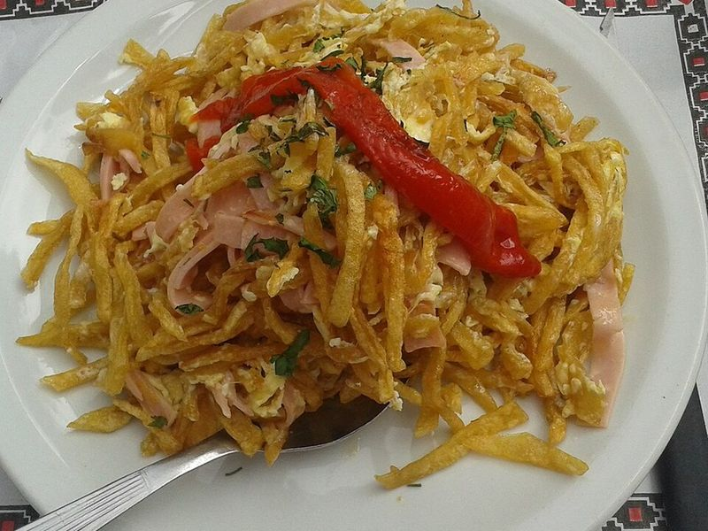

# Revuelto Gramajo (Argentine Ham, Potato & Egg Scramble)

Photo: Neo139 · CC0 · [source](https://commons.wikimedia.org/wiki/File:Revuelto_gramajo.jpg)

**Breakfast** · Argentinian · 30 min · serves 4 · skill 1/3

> A bodegón favorite and famous hangover cure: crisp matchstick potatoes, ham and onion tossed with soft-scrambled eggs and peas, so the fries stay crunchy at the edges.

| Per serving | kcal | Protein | Carbs | Fat | Fiber | Sodium | Cost |
| --- | --- | --- | --- | --- | --- | --- | --- |
| | 500 | 26 g | 41 g | 27 g | 6 g | 980 mg | $1.44 |

Contains: egg, pork

## Ingredients

- 8 eggs
- 6 oz ham, cut into strips
- 1½ lb russet potatoes
- 1 onion, thinly sliced
- 1 cup frozen peas
- 2 tbsp chopped parsley

From the pantry: ⅓ cup oil, salt, pepper

## Steps

1. Peel the potatoes and cut into thin matchsticks. Rinse in cold water and dry very well on a towel.
2. Heat the oil in a large nonstick skillet over medium-high and fry the potatoes in two batches, stirring, until golden and crisp, 6 to 8 minutes. Drain on paper towels and salt.
3. Pour off all but 1 tbsp oil. Cook the onion over medium heat until soft, 5 minutes, then add the ham and peas and cook 2 minutes.
4. Beat the eggs with salt and pepper and pour them into the pan over medium-low. Stir gently until just barely set, 1 to 2 minutes.
5. Fold in the potatoes off the heat so they stay crisp, sprinkle with parsley and serve immediately.

**Tip:** For a 15-minute version, use a bag of store-bought shoestring potato sticks and add them at the very end.

Adapted from [Canal 26](https://www.canal26.com/general/2024/10/20/revuelto-gramajo-historia-ingredientes-y-preparacion-de-uno-de-los-platos-tipicos-de-argentina/).

## Storing

Fridge 1 days · freezer not recommended. Best fresh; the potatoes soften on standing.

