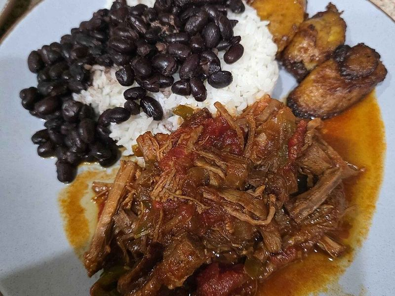

# Cuban Ropa Vieja with Rice & Black Beans

Photo: TGrey89 · CC0 · [source](https://commons.wikimedia.org/wiki/File:RealRopaVieja.jpg)

**Dinner** · Cuban · 150 min · serves 5 · skill 2/3

> Flank steak braised until it pulls into tender shreds, then simmered in a cumin-scented tomato sauce with peppers, onions and briny olives. Cuba's national dish, made for rice and beans.

| Per serving | kcal | Protein | Carbs | Fat | Fiber | Sodium | Cost |
| --- | --- | --- | --- | --- | --- | --- | --- |
| | 715 | 45 g | 88 g | 21 g | 15 g | 1310 mg | $4.51 |

Contains: beef

## Ingredients

- 1½ lb flank steak, cut into 3 pieces
- 2 cups beef broth
- 3 bell peppers, sliced
- 1½ onions, sliced
- 5 garlic cloves, minced
- 1 (14 oz) can crushed tomatoes (half a 28 oz can)
- ½ cup green olives, halved
- 1½ cups long-grain rice
- 2 cans black beans
- cilantro, chopped

From the pantry: 3 tbsp oil, 2 tbsp tomato paste, 2 tsp ground cumin, 1 tsp dried oregano, 1 tbsp white vinegar, 2 bay leaves, 1½ tsp salt, ½ tsp black pepper

## Steps

1. Season the beef with salt and pepper and brown in 1 tbsp oil in a Dutch oven over medium-high, 3 to 4 minutes per side. Add the broth and bay leaves, cover and simmer on low until very tender, 1½ hours.
2. Lift out the beef and shred it with two forks. Save the cooking liquid.
3. Wipe out the pot, add the remaining oil, peppers and onions, and cook over medium until soft, 8 to 10 minutes. Add the garlic, tomato paste, cumin and oregano for 1 minute.
4. Stir in the tomatoes, olives, vinegar, shredded beef and 1 cup of the cooking liquid. Simmer until saucy and thick, 15 minutes. Meanwhile cook the rice and warm the black beans with a pinch of cumin and salt.
5. Serve the ropa vieja over rice with the beans and a scatter of cilantro.

**Tip:** Shred the beef along the grain into long strands, which is how the dish gets its 'old clothes' name and its texture.

## Storing

Fridge 4 days · freezer up to 3 months. Reheat on the stove over medium with a splash of water until simmering, or microwave 2 to 3 minutes.

## Other ways to make it

- Chicken
- Shrimp
- Pork
- Tofu
