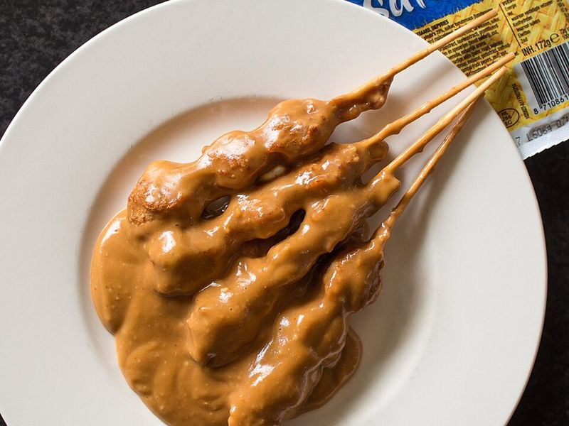

# Sate Ayam (Indonesian Chicken Satay) with Peanut Sauce

Photo: Takeaway · CC BY-SA 4.0 · [source](https://commons.wikimedia.org/wiki/File:2016_0427_Factory-made_satay_babi_Netherlands.jpg)

**Dinner** · Indonesian · 45 min · serves 5 · skill 2/3

> Bite-size chicken thigh skewers lacquered with sweet soy and butter, charred on a hot grill or pan and dunked in a rich, chunky coconut peanut sauce, with rice and cucumber to cool it down.

| Per serving | kcal | Protein | Carbs | Fat | Fiber | Sodium | Cost |
| --- | --- | --- | --- | --- | --- | --- | --- |
| | 760 | 40 g | 74 g | 35 g | 4 g | 1570 mg | $2.39 |

Contains: nuts, gluten, dairy, spicy

## Ingredients

- 1½ lb boneless chicken thighs, in ¾-inch cubes
- 7 tbsp kecap manis, divided
- 2 tbsp butter, melted
- 7 tbsp peanut butter
- ¾ cup coconut milk
- 3 tbsp roasted peanuts, chopped
- 1 small onion, diced
- 2 garlic cloves, minced
- 1 tbsp sambal oelek
- ½ tbsp soy sauce
- 2 limes
- 1 cucumber, in chunks
- 1½ cups jasmine rice

From the pantry: 1 tbsp oil, salt, 16 bamboo skewers (soaked 30 minutes)

## Steps

1. Start the rice. Thread the chicken onto the soaked skewers, 4 to 5 pieces each. Mix 4 tbsp kecap manis with the melted butter and brush it all over.
2. For the sauce, heat the oil in a small saucepan over medium-high and cook the onion, garlic and sambal until the onion is soft, 3 minutes. Lower to medium, add the peanut butter, coconut milk, 3 tbsp kecap manis, soy sauce, ¼ cup water and a pinch of salt, and simmer 8 to 10 minutes, whisking.
3. Blend the sauce smooth with a stick blender, then stir in the chopped peanuts and the juice of 1 lime and simmer 2 minutes more.
4. Grill the skewers over high heat on a grill, grill pan or under the broiler, turning and brushing with any leftover glaze, until charred at the edges and cooked through (165°F), 8 to 10 minutes total.
5. Serve the satay with the peanut sauce, rice, cucumber and lime wedges.

**Tip:** Keep the pieces small so they cook fast and char before drying out. In Indonesia satay comes with compressed rice cakes (lontong); rice is the easy swap.

Adapted from [RecipeTin Eats](https://www.recipetineats.com/satay-chicken-with-peanut-sauce/).

## Storing

Fridge 3 days · freezer up to 2 months. Reheat skewers in a 375°F oven for 8 minutes; warm the sauce with a splash of water.

