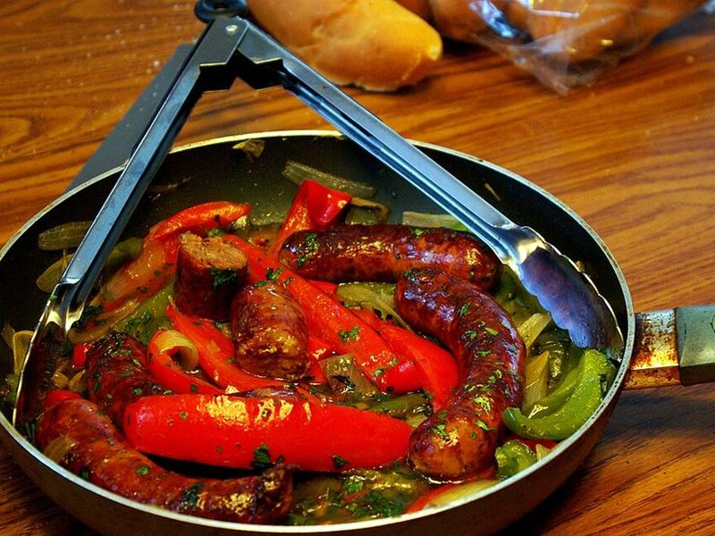

# Italian Sausage & Peppers on Toasted Rolls

Photo: Chuck Falzone · CC BY 2.0 · [source](https://commons.wikimedia.org/wiki/File:Sausage_and_peppers.jpg)

**Dinner** · Italian · 40 min · serves 4 · skill 1/3

> Browned Italian sausages tumbled with sweet, jammy peppers and onions in a splash of tomato, piled into toasted rolls. Street-fair food made in one skillet.

| Per serving | kcal | Protein | Carbs | Fat | Fiber | Sodium | Cost |
| --- | --- | --- | --- | --- | --- | --- | --- |
| | 900 | 39 g | 64 g | 54 g | 7 g | 2340 mg | $3.30 |

Contains: gluten, pork

## Ingredients

- 1¼ lb Italian sausage links (pork or turkey)
- 3 bell peppers, sliced
- 1½ onions, sliced
- 3 garlic cloves, sliced
- 1 cup marinara
- 4 hoagie rolls, split and toasted
- 4 slices provolone (optional)
- a few basil leaves

From the pantry: 2 tbsp olive oil, 1 tsp dried oregano, ¼ tsp red pepper flakes, ½ tsp salt

## Steps

1. Heat 1 tbsp oil in a large skillet over medium. Brown the sausages on all sides, 8 to 10 minutes (they don't need to be cooked through yet). Move to a cutting board.
2. Add the remaining oil, peppers, onions and salt to the pan. Cook, stirring, until soft and browned at the edges, 10 to 12 minutes. Add the garlic, oregano and pepper flakes for 1 minute.
3. Slice the sausages thickly and return them to the pan with the marinara and ¼ cup water. Cover and simmer until the sausage is 160°F inside (165°F for turkey), 8 to 10 minutes.
4. Lay provolone in the toasted rolls, pile in the sausage and peppers, and top with basil.

**Tip:** For a no-bread night, serve it over soft polenta or creamy grits instead of rolls.

## Storing

Fridge 4 days · freezer up to 3 months. Keep the filling separate from the bread. Reheat in a skillet with a splash of water, 5 minutes, then fill fresh-toasted rolls.

## Other ways to make it

- Ground beef
- Ground turkey
- Ground pork
- Lentils (veg)
