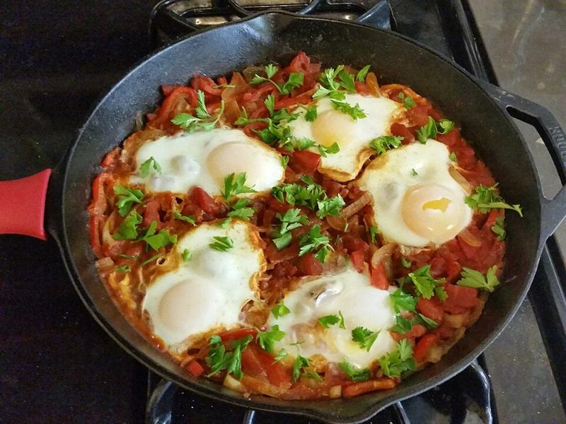

# Shakshuka with Feta & Warm Pita

Photo: Calliopejen1 · CC BY-SA 3.0 · [source](https://commons.wikimedia.org/wiki/File:Shakshuka_by_Calliopejen1.jpg)

**Breakfast** · Middle Eastern · 30 min · serves 4 · skill 2/3

> Eggs gently poached in a smoky, peppery tomato sauce, crowned with feta and herbs. Bring the skillet to the table with pita for dunking.

| Per serving | kcal | Protein | Carbs | Fat | Fiber | Sodium | Cost |
| --- | --- | --- | --- | --- | --- | --- | --- |
| | 505 | 22 g | 54 g | 24 g | 6 g | 1320 mg | $1.89 |

Contains: egg, dairy, gluten

## Ingredients

- 6 eggs
- 2 cans diced tomatoes
- 1 red bell pepper, diced
- 1 onion, diced
- 3 garlic cloves, sliced
- 1½ tsp smoked paprika
- ½ cup feta crumbles
- cilantro or parsley
- 4 pita breads, warmed

From the pantry: 3 tbsp olive oil, 1 tsp cumin, pinch of sugar, salt

## Steps

1. Cook the onion and pepper in the oil in a 12-inch skillet over medium until soft, 7 minutes.
2. Add the garlic, paprika and cumin for 1 minute, then the tomatoes, sugar and ½ tsp salt. Simmer until thick, 10 minutes.
3. Make 6 wells with a spoon and crack an egg into each. Season the eggs.
4. Cover and cook on medium-low until the whites are set and the yolks still runny, 6 to 8 minutes.
5. Scatter with feta and herbs and serve straight from the pan with warm pita.

**Tip:** Crack each egg into a small cup first so a broken yolk doesn't end up in the pan.

## Storing

Fridge 2 days · freezer not recommended. Store leftover sauce without eggs. Reheat the sauce in a skillet and poach fresh eggs in it.

