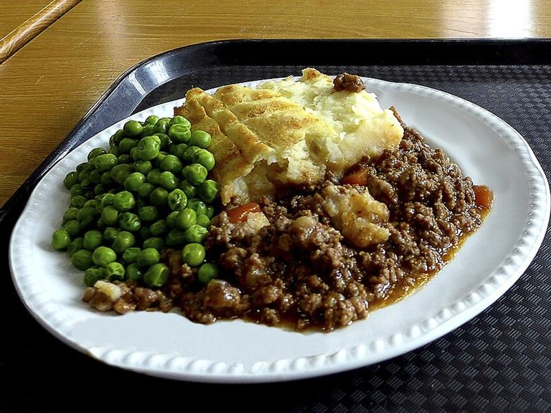

# Shepherd's Pie with Cheddar Mashed Potato Crust

Photo: Oxfordian Kissuth · CC BY-SA 3.0 · [source](https://commons.wikimedia.org/wiki/File:Homerton_College_-_Shepherd%27s_pie_(cropped).jpg)

**Dinner** · British & Irish · 75 min · serves 6 · skill 2/3

> A savory, thyme-scented ground meat and vegetable filling under a golden, fluffy cheddar mash. Made with beef it's technically cottage pie; with turkey it's lighter but just as cozy.

| Per serving | kcal | Protein | Carbs | Fat | Fiber | Sodium | Cost |
| --- | --- | --- | --- | --- | --- | --- | --- |
| | 690 | 32 g | 52 g | 40 g | 8 g | 670 mg | $2.26 |

Contains: dairy, beef

## Ingredients

- 1½ lb ground beef or ground turkey
- 2½ lb russet potatoes, peeled and in chunks
- 4 tbsp butter
- ¾ cup milk
- 1 cup shredded sharp cheddar
- 1 onion, diced
- 2 to 3 carrots, diced
- 2 celery stalks, diced
- 3 garlic cloves, minced
- 1½ cups frozen peas and corn (or mixed vegetables)
- 1 cup beef broth

From the pantry: 1 tbsp oil, 2 tbsp tomato paste, 1 tbsp cornstarch, 1 tsp dried thyme, ½ tsp dried rosemary, 2 tsp salt, ½ tsp black pepper

## Steps

1. Boil the potatoes in salted water until very tender, 15 to 18 minutes. Drain well and mash with the butter, milk, half the cheddar and 1 tsp salt. Heat the oven to 400°F.
2. Meanwhile brown the meat in the oil in a large ovenproof skillet over medium-high, breaking it up, 6 to 8 minutes. Spoon off excess fat if using beef.
3. Add the onion, carrots and celery and cook until softening, 6 minutes. Stir in the garlic, tomato paste, thyme and rosemary for 1 minute.
4. Whisk the cornstarch into the broth and add it with the frozen vegetables, remaining salt and the pepper. Simmer until thick and glossy, 3 to 4 minutes.
5. Spread the mash over the filling, rough it up with a fork and scatter over the remaining cheddar. Bake until bubbling and golden on top, 20 to 25 minutes. Rest 10 minutes before serving.

**Tip:** Dragging a fork across the mash makes ridges that brown into crispy edges. Run it under the broiler for 2 minutes if you want it extra golden.

## Storing

Fridge 4 days · freezer up to 3 months. Reheat covered at 350°F for 20 to 25 minutes, or microwave portions 2 to 3 minutes.

## Other ways to make it

- Ground turkey
- Ground pork
- Italian sausage
- Lentils (veg)
