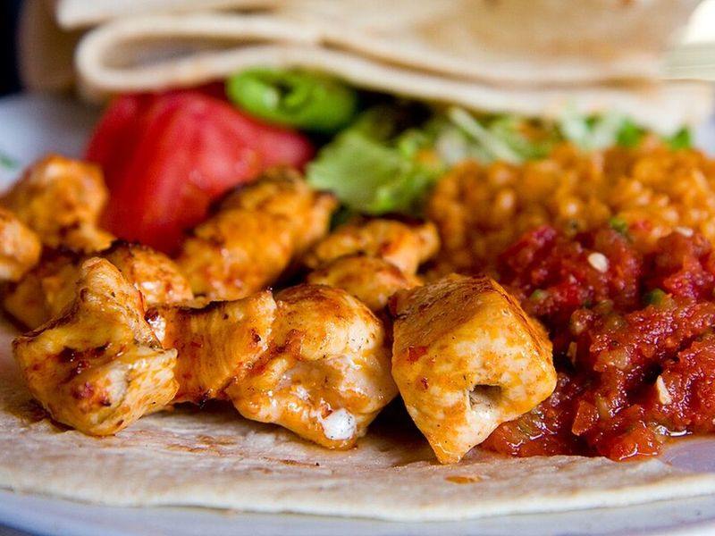

# Shish Tawook with Toum, Pita & Pickles

Photo: Garrett Ziegler · CC BY-SA 4.0 · [source](https://commons.wikimedia.org/wiki/File:Tavuk_%C5%9Ei%C5%9F.jpg)

**Dinner** · Lebanese & Levantine · 45 min · serves 4 · skill 2/3

> Lebanese grill-house chicken: chunks marinated in yogurt, lemon, garlic, tomato paste and warm spices, charred on skewers and served with whipped garlic toum, warm pita and crunchy pickles.

| Per serving | kcal | Protein | Carbs | Fat | Fiber | Sodium | Cost |
| --- | --- | --- | --- | --- | --- | --- | --- |
| | 715 | 61 g | 45 g | 32 g | 3 g | 1220 mg | $3.02 |

Contains: gluten, dairy

## Ingredients

- 2 lb boneless chicken breasts, in 1½-inch cubes
- ½ cup plain yogurt
- 2 lemons, juiced
- 1 bulb plus 2 garlic cloves
- 4 pitas
- pickles
- 2 tomatoes, sliced
- a handful of parsley

From the pantry: ½ cup neutral oil, 2 tbsp olive oil, 1 tbsp tomato paste, 1 tsp paprika, 1 tsp allspice, ½ tsp cinnamon, ½ tsp ground ginger, ½ tsp dried oregano, ¼ tsp nutmeg, salt

## Steps

1. Mix the yogurt, olive oil, juice of 1 lemon, 4 crushed garlic cloves, tomato paste, all the spices and 1½ tsp salt. Toss the chicken in it and refrigerate at least 1 hour, up to 8.
2. For the toum, blend the remaining peeled garlic cloves (about 10) with ½ tsp salt in a small food processor until finely minced. With the motor running, drizzle in the neutral oil very slowly, alternating with the remaining lemon juice a spoonful at a time, until thick, white and fluffy like mayonnaise.
3. Thread the chicken onto skewers (soak wooden ones for 20 minutes). Heat a grill or grill pan to medium-high.
4. Grill the skewers, turning every few minutes, until charred in spots and 165°F inside, 10 to 14 minutes.
5. Warm the pita on the grill for 30 seconds a side. Serve the chicken with pita, toum, pickles, tomato and parsley.

**Tip:** If the toum breaks and turns runny, start again with 1 egg white (or an ice cube) in a clean bowl and slowly blend the broken sauce back in. No grill? Cook the chicken unskewered in a hot cast-iron pan, 6 to 8 minutes.

Adapted from [Simply Lebanese](https://www.simplyleb.com/recipe/shish-tawook/).

## Storing

Fridge 3 days · freezer up to 2 months. Store chicken and toum separately; toum keeps a week. Reheat chicken in a 375°F oven or skillet for 5 to 6 minutes.

