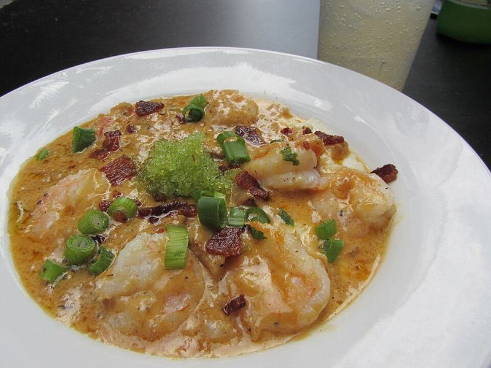

# Cheesy Shrimp & Grits

Photo: Jason Riedy · CC BY 2.0 · [source](https://commons.wikimedia.org/wiki/File:Shrimp_and_grits_at_the_Green_Goddess.jpg)

**Dinner** · Southern & Cajun · 35 min · serves 4 · skill 2/3

> Creamy cheddar grits under garlicky Cajun shrimp in a buttery bacon pan sauce with a squeeze of lemon. Lowcountry comfort.

| Per serving | kcal | Protein | Carbs | Fat | Fiber | Sodium | Cost |
| --- | --- | --- | --- | --- | --- | --- | --- |
| | 880 | 55 g | 79 g | 38 g | 5 g | 1850 mg | $3.94 |

Contains: shellfish, dairy, pork

## Ingredients

- 1 cup quick grits
- 2 cups milk (plus 2 cups water)
- 2 cups shredded sharp cheddar
- 4 tbsp butter
- 6 slices bacon, chopped
- 1 lb shrimp, peeled
- 2 tsp Cajun seasoning
- 3 garlic cloves
- 1 lemon
- green onions

From the pantry: Salt, pepper, hot sauce

## Steps

1. Bring the milk, 2 cups water and 1 tsp salt to a simmer. Whisk in the grits and cook, stirring, until thick, 5 to 7 minutes. Stir in the cheddar and 2 tbsp butter. Keep warm.
2. Cook the bacon until crisp. Remove, leaving the fat in the pan.
3. Toss the shrimp with the Cajun seasoning and sear in the bacon fat 1 to 2 minutes per side.
4. Add the garlic, remaining butter, juice of half the lemon and 2 tbsp water. Toss until saucy.
5. Spoon the shrimp and sauce over the grits. Top with bacon and green onions.

**Tip:** If the grits stiffen while they wait, whisk in a splash of hot milk.

## Storing

Fridge 2 days · freezer not recommended. Whisk the grits with hot milk to loosen. Warm the shrimp gently.

## Other ways to make it

- Chicken
- Steak
- Pork
- Tofu
