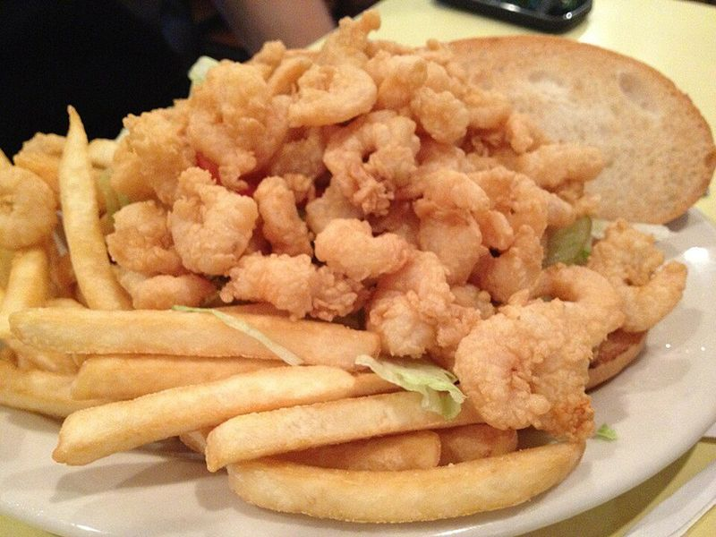

# Fried Shrimp Po' Boys with Cajun Rémoulade

Photo: David Reber · CC BY-SA 2.0 · [source](https://commons.wikimedia.org/wiki/File:Shrimp_PoBoy_Middendorfs.jpg)

**Lunch** · Cajun & Creole · 45 min · serves 4 · skill 2/3

> Buttermilk-soaked shrimp in a crunchy cornmeal crust, piled into toasted rolls dressed New Orleans style with lettuce, tomato, pickles and a punchy rémoulade.

| Per serving | kcal | Protein | Carbs | Fat | Fiber | Sodium | Cost |
| --- | --- | --- | --- | --- | --- | --- | --- |
| | 760 | 48 g | 71 g | 33 g | 5 g | 1500 mg | $4.13 |

Contains: gluten, shellfish, dairy, egg

## Ingredients

- 1½ lb large shrimp, peeled and deveined
- 1 cup buttermilk
- ¾ cup cornmeal
- 4 soft French or hoagie rolls
- 1 romaine heart, finely shredded
- 2 tomatoes, sliced
- dill pickle chips, plus 1 tbsp brine
- ½ lemon

From the pantry: ⅓ cup mayo, ¾ cup flour, 2 tbsp Cajun or Creole seasoning, 2 tsp garlic powder, 2 tsp paprika, 1 tsp dried thyme, 3 tbsp hot sauce, 1 tsp Worcestershire, oil for frying, salt

## Steps

1. Mix the Cajun seasoning, garlic powder, paprika and thyme. Toss the shrimp with the buttermilk, 2 tbsp hot sauce and a third of the spice mix and refrigerate for 30 minutes to an hour.
2. For the rémoulade, stir the mayo with a finely chopped pickle or two, the pickle brine, Worcestershire, a squeeze of lemon, 1 tbsp hot sauce and 1 tsp of the spice mix. Chill until needed.
3. Heat 1 inch of oil in a heavy skillet to 350°F. Whisk the flour, cornmeal and the rest of the spice mix in a shallow dish. Lift the shrimp from the buttermilk, let the excess drip off and dredge well.
4. Fry in batches without crowding until deep golden and crisp, 2 to 3 minutes, turning once. Drain on a rack and sprinkle with a little salt.
5. Split and lightly toast the rolls. Spread both sides with rémoulade, then pile on lettuce, tomato, pickles and plenty of shrimp. Serve right away.

**Tip:** Real New Orleans po' boy bread (like Leidenheimer) is crackly outside and airy inside; a light, crisp-crusted French roll is the closest supermarket match. Avoid dense sub rolls.

Adapted from [Laura in the Kitchen](https://www.laurainthekitchen.com/recipes/shrimp-po-boy/).

## Storing

Fridge 1 days · freezer not recommended. Best eaten fresh. Re-crisp leftover shrimp in a 400°F oven or air fryer for 5 minutes and build the sandwich then.

