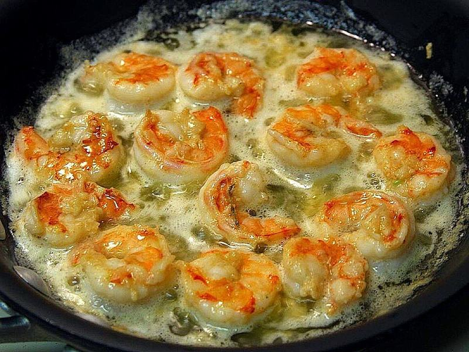

# Garlic Butter Shrimp Scampi Linguine

Photo: Jon Sullivan · Public domain · [source](https://commons.wikimedia.org/wiki/File:Scampi_served.jpg)

**Dinner** · Italian · 25 min · serves 4 · skill 1/3

> Plump shrimp in a lemony, garlicky butter sauce with a pinch of chili, tossed with linguine and plenty of parsley.

| Per serving | kcal | Protein | Carbs | Fat | Fiber | Sodium | Cost |
| --- | --- | --- | --- | --- | --- | --- | --- |
| | 735 | 41 g | 90 g | 25 g | 5 g | 900 mg | $3.11 |

Contains: shellfish, dairy, gluten

## Ingredients

- 1 lb large shrimp, peeled
- 1 lb linguine or spaghetti
- 5 tbsp butter
- 8 garlic cloves, thinly sliced
- 2 lemons
- ½ cup broth or dry white wine
- 1 bunch parsley, chopped
- Parmesan, to serve

From the pantry: 2 tbsp olive oil, red pepper flakes, salt, pepper

## Steps

1. Boil the pasta in well-salted water. Save 1 cup pasta water.
2. Season the shrimp. Heat the oil and 1 tbsp butter in a large skillet over medium-high and cook the shrimp 1 minute per side. Move to a plate.
3. Lower the heat and add 2 tbsp butter, the garlic and pepper flakes. Cook gently until the garlic is pale gold, 2 minutes.
4. Add the broth or wine and the juice of 1 lemon and simmer 2 minutes. Add the pasta, remaining butter and a splash of pasta water and toss until glossy.
5. Return the shrimp, add the parsley and lemon zest, and toss. Serve with lemon wedges and Parmesan.

**Tip:** Pull the shrimp while they're still slightly translucent. They finish cooking in the sauce.

## Storing

Fridge 2 days · freezer not recommended. Add a splash of water or milk and microwave covered 1½ to 2 minutes, stirring halfway.

## Other ways to make it

- Chicken
- Steak
- Pork
- Tofu
