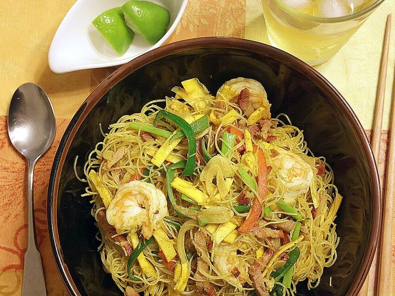

# Singapore Curry Rice Noodles with Shrimp & Egg

Photo: Frank Sheeran · CC BY-SA 4.0 · [source](https://commons.wikimedia.org/wiki/File:R5_2023_08_02_0147-singapore-noodles.jpg)

**Lunch** · Chinese & Cantonese · 30 min · serves 4 · skill 2/3

> The Hong Kong cha chaan teng classic: springy rice vermicelli stir-fried with curry powder, plump shrimp, ribbons of omelet and crisp peppers. Light, golden and done in half an hour.

| Per serving | kcal | Protein | Carbs | Fat | Fiber | Sodium | Cost |
| --- | --- | --- | --- | --- | --- | --- | --- |
| | 555 | 35 g | 67 g | 16 g | 6 g | 1300 mg | $3.56 |

Contains: gluten, shellfish, egg

## Ingredients

- 8.8 oz rice vermicelli
- 1 lb raw peeled shrimp
- 3 eggs, beaten
- 1 onion, thinly sliced
- 1 red bell pepper, thinly sliced
- 2 cups bean sprouts
- 4 green onions, in 2-inch lengths
- 4 garlic cloves, minced
- 1 tsp grated ginger
- ¼ cup soy sauce
- 3 tbsp Shaoxing wine
- 5 tsp curry powder

From the pantry: 1 tsp sugar, ½ tsp white pepper, 3 tbsp oil, salt

## Steps

1. Soak the vermicelli in very hot tap water until soft but still springy, 5 to 8 minutes, then drain well and snip it a few times with scissors. Stir the soy, Shaoxing wine, curry powder, sugar and white pepper together.
2. Heat 1 tbsp oil in a wok or large nonstick skillet over medium-high. Cook the shrimp until pink and just opaque, about 2 minutes, and move them to a plate.
3. Add a little oil, pour in the eggs and swirl into a thin omelet. When set, about 1 minute, roll it up, slide it out and slice it into ribbons.
4. Add the rest of the oil with the onion, garlic and ginger and stir-fry for 2 minutes. Add the pepper and cook 1 minute more.
5. Add the noodles and the sauce and toss with tongs until every strand is evenly yellow, 1 to 2 minutes. Return the shrimp and egg with the bean sprouts and green onions and toss until hot, about 1 minute more.

**Tip:** Toss the noodles with tongs or chopsticks rather than stirring with a spatula, so they stay in long strands instead of breaking into mush. Takeout versions also add thin slices of char siu pork.

Adapted from [RecipeTin Eats](https://www.recipetineats.com/singapore-noodles/).

## Storing

Fridge 3 days · freezer not recommended. Reheat in a hot skillet with a splash of water, or microwave covered.

