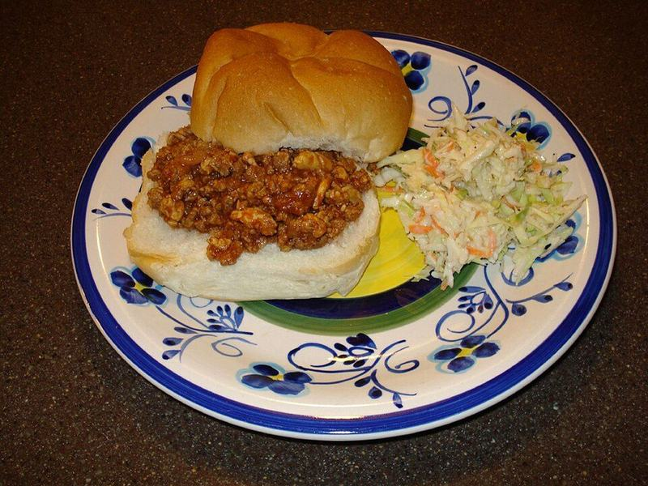

# Saucy Turkey Sloppy Joes

Photo: Buck Blues · CC BY 2.0 · [source](https://commons.wikimedia.org/wiki/File:Sloppy_Joe_%22homemade%22.jpg)

**Lunch** · American comfort · 30 min · serves 4 · skill 1/3

> Tangy-sweet, tomato-rich ground turkey with peppers and onions, spooned onto toasted brioche buns. A messy, nostalgic lunch that reheats beautifully.

| Per serving | kcal | Protein | Carbs | Fat | Fiber | Sodium | Cost |
| --- | --- | --- | --- | --- | --- | --- | --- |
| | 610 | 41 g | 64 g | 22 g | 5 g | 1320 mg | $2.46 |

Contains: gluten, dairy, egg

## Ingredients

- 1½ lb ground turkey
- 1¾ cups crushed tomatoes
- 4 brioche buns
- 1 onion, finely diced
- 1 green bell pepper, finely diced
- 2 garlic cloves, minced
- dill pickle chips, for serving

From the pantry: 1 tbsp oil, ⅓ cup ketchup, 2 tbsp brown sugar, 1 tbsp Worcestershire sauce, 1 tbsp yellow mustard, 1 tsp chili powder, 1 tsp cider vinegar, salt, pepper

## Steps

1. Heat the oil in a large skillet over medium-high. Add the turkey, onion and pepper and cook, breaking up the meat, until the turkey is browned with no pink and the vegetables are soft, 8 to 10 minutes.
2. Stir in the garlic and chili powder and cook 30 seconds.
3. Add the crushed tomatoes, ketchup, brown sugar, Worcestershire, mustard and vinegar. Simmer, stirring often, until thick enough to hold its shape on a spoon, 8 to 10 minutes.
4. Season with salt and pepper. Meanwhile, toast the cut sides of the buns in a dry pan or under the broiler until golden.
5. Pile the filling on the buns and serve with pickles.

**Tip:** Ground turkey is lean, so let the sauce reduce until thick; that's what keeps it from soaking straight through the bun.

## Storing

Fridge 4 days · freezer up to 3 months. Store the filling separately from the buns. Reheat in a covered pan or microwave until steaming.

## Other ways to make it

- Ground beef
- Ground pork
- Italian sausage
- Lentils (veg)
