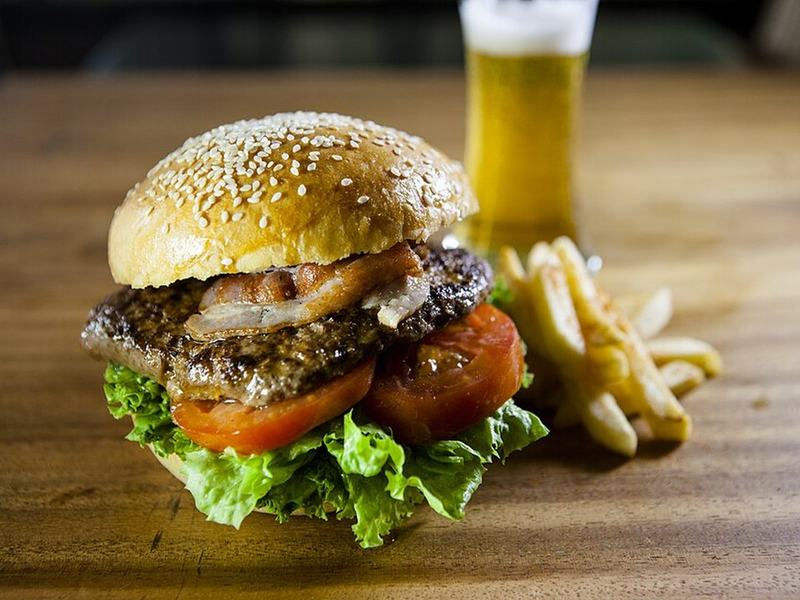

# Double Smash Burgers

Photo: Hongreddotbrewhouse · CC BY-SA 3.0 · [source](https://commons.wikimedia.org/wiki/File:RedDot_Burger.jpg)

**Dinner** · American comfort · 20 min · serves 4 · skill 1/3

> Two thin, lacy-edged patties smashed hard on a screaming-hot pan, melted cheddar, special sauce and pickles on a toasted brioche bun.

| Per serving | kcal | Protein | Carbs | Fat | Fiber | Sodium | Cost |
| --- | --- | --- | --- | --- | --- | --- | --- |
| | 970 | 47 g | 44 g | 67 g | 3 g | 1750 mg | $3.04 |

Contains: beef, dairy, gluten, egg

## Ingredients

- 1⅓ lb 80/20 ground beef, in 8 loose balls
- 8 slices cheddar or American
- 4 brioche buns
- ½ onion, paper-thin
- dill pickle chips
- shredded lettuce

From the pantry: Special sauce: ⅓ cup mayo, 2 tbsp ketchup, 1 tbsp pickle brine, 1 tsp mustard. Plus butter, salt, pepper

## Steps

1. Stir together the special sauce. Butter and toast the buns in a cast-iron skillet. Set aside.
2. Heat the skillet over high heat until smoking. Add 2 beef balls and smash each paper-thin with a sturdy spatula. Season with salt and pepper.
3. Cook undisturbed until deeply browned with crispy edges, 2 minutes. Scrape under the patties and flip.
4. Add a slice of cheese to each and stack the two patties. Cook 30 seconds more.
5. Build: bun, sauce, lettuce, onion, double patty, pickles, sauce, top bun. Repeat.

**Tip:** Keep the beef cold and don't press it into patties first. Loose balls give the craggy, crispy edges.

## Storing

Fridge 3 days · freezer up to 2 months. Cook patties fresh if you can. Reheat leftovers in a hot skillet, 1 minute per side.

## Other ways to make it

- Ground turkey
- Ground pork
- Italian sausage
- Lentils (veg)
