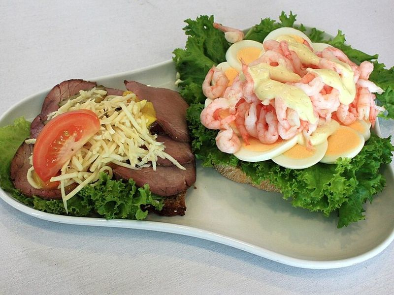

# Smørrebrød (Danish Open-Faced Rye Sandwiches)

Photo: Anneli Salo · CC BY-SA 3.0 · [source](https://commons.wikimedia.org/wiki/File:Sm%C3%B8rrebr%C3%B8d_at_Kastrup_IMG_8275_C.JPG)

**Lunch** · Scandinavian · 25 min · serves 4 · skill 1/3

> Copenhagen's lunch staple: buttered dark rye topped three ways, with smoked salmon and dill, roast beef with homemade remoulade and pickles, and egg with cucumber.

| Per serving | kcal | Protein | Carbs | Fat | Fiber | Sodium | Cost |
| --- | --- | --- | --- | --- | --- | --- | --- |
| | 535 | 30 g | 45 g | 27 g | 6 g | 2240 mg | $3.98 |

Contains: gluten, dairy, egg, fish, beef

## Ingredients

- 12 thin slices dark rye bread
- 2 tbsp soft butter
- 4 oz smoked salmon
- 8 oz sliced roast beef
- 4 eggs, hard-boiled and sliced
- ½ English cucumber, thinly sliced
- dill pickle slices, plus 1 tbsp chopped
- 1 tsp capers, chopped
- fresh dill sprigs
- 1 lemon, thinly sliced
- a handful of greens or pea shoots

From the pantry: ¼ cup mayo, 1 tsp Dijon mustard, ⅛ tsp curry powder, 1 tsp lemon juice, 1 tbsp chopped parsley, salt, pepper

## Steps

1. Make the remoulade: stir the mayo, chopped pickles, capers, parsley, lemon juice, mustard and curry powder together.
2. Lightly butter every slice of rye bread right to the edges; it keeps the toppings from soaking in.
3. Salmon: fold the salmon onto 4 slices and top with a lemon slice, dill and a little black pepper.
4. Roast beef: layer the beef on 4 slices, spoon on remoulade and finish with pickle slices and a few greens.
5. Egg: overlap egg and cucumber slices on the last 4 slices, add a dab of remoulade, salt, pepper and dill. Serve 3 per person, eaten with a knife and fork.

**Tip:** Look for dense, seeded Danish-style rugbrød or German pumpernickel; soft deli rye is too light. Smoked herring with a raw egg yolk ('sol over Gudhjem') is a classic topping to try.

Adapted from [Caroline's Cooking](https://www.carolinescooking.com/danish-smorrebrod/).

## Storing

Fridge 1 days · freezer not recommended. Assemble just before eating. The remoulade keeps 4 days in the fridge.

